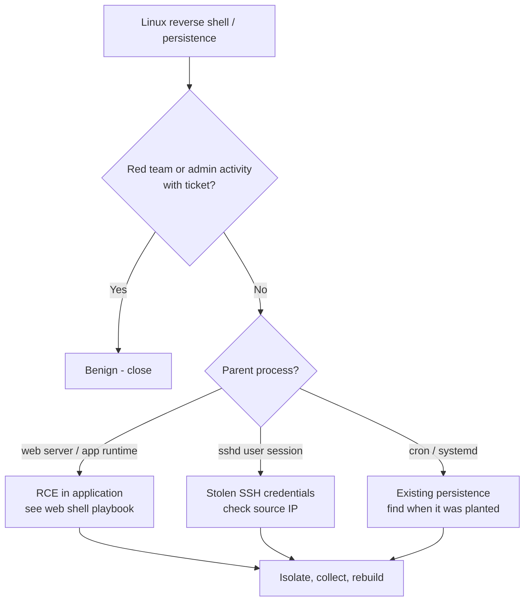

# Linux Reverse Shell and Persistence

> Interactive attacker access on a Linux server, usually followed by SSH-key or cron persistence and often a cryptominer.

## When this fires
- `lnx_reverse_shell` (SecOps): Classic reverse shell one-liners: bash /dev/tcp, nc -e, socat exec, python/perl/php socket shells and mkfifo pipes
- `lnx_download_pipe_to_shell` (SecOps): curl or wget output piped straight into a shell - remote code execution pattern used by cryptominers, botnets and post-exploitation scripts
- `lnx_ssh_authorized_keys_modified` (SecOps): A command appends to or replaces an authorized_keys file - SSH key backdoor for persistent access
- `lnx_cron_persistence` (SecOps): A command writes into crontab files or spool directories, or reinstalls a crontab from a script - scheduled persistence
- `lnx_crypto_miner` (SecOps): Cryptocurrency miner binaries or arguments (xmrig, stratum+tcp, --donate-level, mining pools)
- `lnx_history_tampering` (SecOps): Shell history cleared or disabled (history -c, unset HISTFILE, HISTSIZE=0, linking history to /dev/null)
- `linux-reverse-shell` (Sentinel): Reverse shell one-liners on Linux endpoints/servers (bash /dev/tcp, nc -e, socat exec, python/perl/php socket shells, mkfifo pipes) from Defender for Endpoint on Linux
- `linux-download-and-execute` (Sentinel): curl/wget piped straight into a shell, or a binary executed from /tmp, /dev/shm or /var/tmp
- `crypto-miner` (Sentinel): Process names or command-line arguments typical of crypto miners (xmrig, stratum+tcp, --donate-level, mining pool hosts), on Windows or Linux

## Triage decision tree

## Investigation steps
1. Destination IP/port of the reverse shell; enrich and hunt across the fleet.
2. Persistence sweep on the host: `crontab -l` for all users, `/etc/cron*`, systemd units, `~/.ssh/authorized_keys`, `/etc/ld.so.preload`, new users in `/etc/passwd`.
3. Entry vector: web server logs, SSH auth logs (`lnx_ssh_bruteforce`), vulnerable services.
4. Impact: cryptominer CPU use, credential files read (`/etc/shadow`, cloud credentials in `~/.aws`).

## True vs false positive

| Points to attack | Points to benign |
|---|---|
| `bash -i >& /dev/tcp/…`, `nc -e`, or a Python pty spawned by a web or DB process | Administrator using `nc` for a documented connectivity test |
| Download piped to shell from a raw IP or paste site | Vendor install script from the vendor's official domain |
| New SSH key or cron entry right after | Configuration management (Ansible, Puppet) run with a known source |

## Containment & response
- Isolate the host (security group / firewall / EDR).
- Prefer **rebuild from a known-good image** over cleanup.
- Rotate SSH keys, cloud credentials and secrets present on the host.

## Escalation criteria
Always IR for confirmed reverse shells. Cloud credentials on the host → also run the cloud credential playbook.

## Evidence to collect
Command lines, attacker IPs, persistence artifacts, bash history (if not wiped), memory / disk snapshot.
