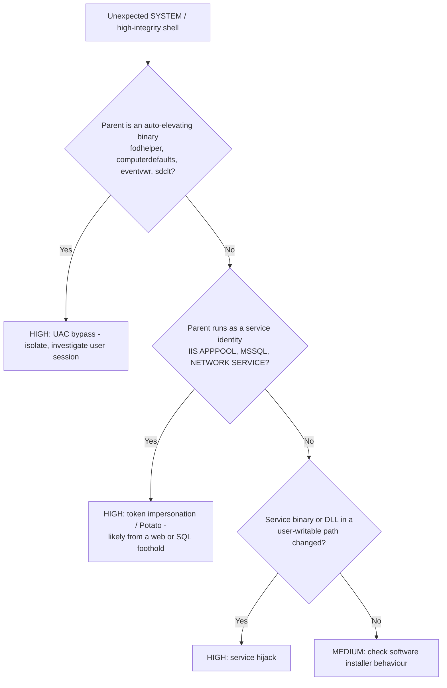

# Local Privilege Escalation (UAC Bypass, Potato, Service Abuse)

> Between initial access and credential theft, there is almost always a step from user or service account to **SYSTEM / high integrity**: a UAC bypass (`fodhelper`, `computerdefaults`), a "Potato" token abuse from a service account (IIS, SQL), a writable service binary, or a kernel exploit. Catch it here and the attacker never reaches LSASS.

## When this fires
**Hunt-driven.** Run daily on servers and weekly on workstations. EDR products alert on many of these individually. This playbook covers deciding on and scoping them.

## Triage decision tree


## Investigation steps
1. Shells launched with SYSTEM or high integrity from unusual parents:
   ```kql
   DeviceProcessEvents
   | where TimeGenerated > ago(1d)
   | where FileName in~ ("cmd.exe", "powershell.exe", "pwsh.exe", "rundll32.exe")
   | where ProcessIntegrityLevel in ("System", "High")
   | where InitiatingProcessFileName in~ ("fodhelper.exe", "computerdefaults.exe", "eventvwr.exe", "sdclt.exe", "slui.exe", "wsreset.exe", "w3wp.exe", "sqlservr.exe", "printspoofer.exe")
       or InitiatingProcessAccountName has_any ("APPPOOL", "MSSQL", "NETWORK SERVICE", "LOCAL SERVICE")
   | project TimeGenerated, DeviceName, AccountName, ProcessIntegrityLevel, FileName, ProcessCommandLine, InitiatingProcessFileName, InitiatingProcessAccountName
   ```
2. UAC bypass registry staging (`HKCU\Software\Classes\ms-settings\shell\open\command`, `mscfile`, `exefile`) in `DeviceRegistryEvents` shortly before the elevation.
3. Service and DLL hijacks: services whose binary path changed (`sc config binPath=`), or DLLs written into folders that services load from.
4. For service-account parents (IIS / SQL), go back to the web or database foothold ([web shell](webshell.md), [database abuse](../data/dam-database-abuse.md)).

## True vs false positive

| Points to attack | Points to benign |
|---|---|
| `fodhelper.exe` spawning `cmd.exe` after an ms-settings registry write | IT support tool elevating via a documented method |
| `w3wp.exe` (IIS APPPOOL) child running as SYSTEM | Software installer spawning an elevated helper |
| Service binary replaced in a world-writable folder | Patch management updating a service binary |

## Containment & response
- Isolate the host; collect the exploit or tool, and the process tree.
- Reset credentials that were present on the host after elevation (SYSTEM can read LSASS).
- Patch the abused vulnerability; fix writable service paths and unquoted service paths.
- Set UAC to *Always notify* for admins, remove local admin rights from users, and run service accounts with the least privilege (no `SeImpersonatePrivilege` where avoidable).

## Escalation criteria
Elevation on a server, from a web or SQL service identity, or followed by credential access → IR.

## Evidence to collect
Process tree with integrity levels, registry staging events, service configuration before and after, exploit artefacts.
