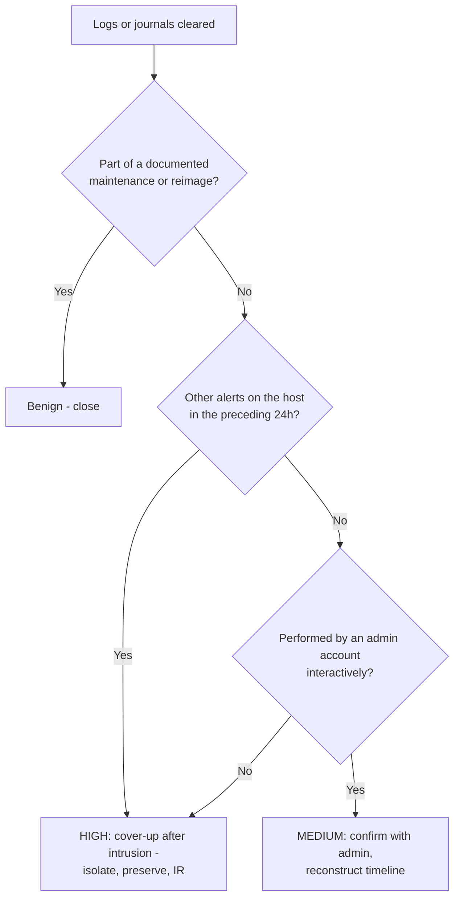

# Log Clearing and Anti-Forensics

> Clearing event logs, deleting the USN journal or wiping shell history are actions only two groups take: admins tidying up, which is rare, and attackers covering their tracks, which is common. **The logs you no longer have are the clue.** Rebuild the timeline from other sources.

## When this fires
- `win_security_log_cleared` / `security-log-cleared`: Security 1102 or System 104 (log cleared), or `wevtutil cl`
- `win_usn_journal_deletion`: `fsutil usn deletejournal`
- `lnx_log_deletion` / `lnx_history_tampering`: removal or truncation of `/var/log/*`, `history -c`, `unset HISTFILE`, `HISTSIZE=0`

## Triage decision tree


## Investigation steps
1. Find who cleared what, and when:
   ```kql
   SecurityEvent
   | where TimeGenerated > ago(7d) and EventID == 1102
   | project TimeGenerated, Computer, Account = SubjectUserName, SubjectDomainName, Activity
   | union (Event | where TimeGenerated > ago(7d) and EventLog == "System" and EventID == 104
       | project TimeGenerated, Computer, Account = UserName, SubjectDomainName = "", Activity = RenderedDescription)
   ```
2. Rebuild the missing window from sources the attacker could not clear: **the SIEM copy** (events forwarded before deletion), EDR telemetry, DC authentication logs, firewall and proxy logs.
3. Look for the gap: a host that stops sending Security events while still sending heartbeats.
4. On Linux, compare `auditd` records and the SIEM copy of `auth.log` against what is left on disk.
5. SecOps pivot:
   ```
   principal.hostname = "<HOST>" AND (metadata.product_event_type = "1102" OR metadata.product_event_type = "104")
   ```

## True vs false positive

| Points to attack | Points to benign |
|---|---|
| Cleared minutes after a suspicious logon or tool execution | Golden image preparation (sysprep) |
| Several logs cleared at once (Security, System, PowerShell) | A single application log cleared by a vendor script |
| Account is not normally an admin of the host | Documented maintenance by the server owner |

## Containment & response
- Isolate the host and preserve volatile evidence (memory) **before** anything else is lost.
- Forward logs in near real time to the SIEM and raise the local log size, so local clearing loses nothing.
- Restrict who holds *Manage auditing and security log* rights; alert on 1102 / 104 on every server.

## Escalation criteria
Clearing with any other suspicious activity, on a DC or tier-0 host, or on multiple hosts → IR.

## Evidence to collect
1102 / 104 events, the SIEM copy of the missing window, EDR timeline, and memory image if possible.
