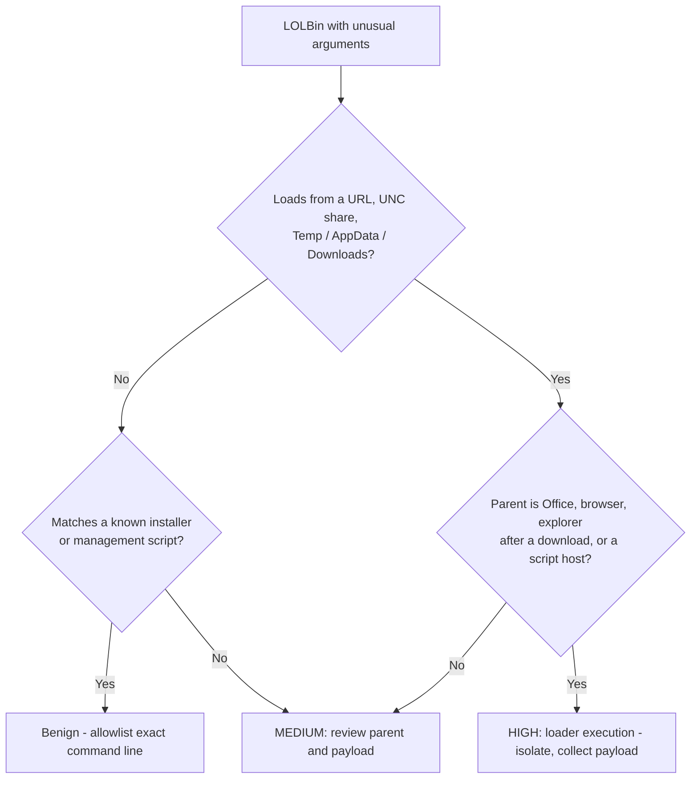

# LOLBin / Signed Binary Proxy Execution

> `mshta`, `rundll32`, `regsvr32`, `msbuild`, `installutil`, `cmstp` and `certutil` are signed Microsoft binaries that can fetch and run attacker code while **looking like Windows**. They show up in almost every loader chain (phishing, ClickFix, HTML smuggling). The question is always **what did it load, and from where?**

## When this fires
- `win_lolbin_remote_payload` / `lolbin-outbound-connection`: a LOLBin with a URL or UNC path in its command line, or making outbound connections
- `win_cmstp_odbcconf_proxy`, `win_msbuild_installutil_proxy`: proxy execution of DLLs, INF or inline project files
- `win_certutil_decode`: `certutil -decode` / `-urlcache` used to download or decode payloads
- `unsigned-binary-from-user-path`: the payload that usually follows

## Triage decision tree


## Investigation steps
1. The LOLBin execution with its parent and command line:
   ```kql
   let host = "<DEVICE_NAME>";
   DeviceProcessEvents
   | where TimeGenerated > ago(2d) and DeviceName startswith host
   | where FileName in~ ("mshta.exe", "rundll32.exe", "regsvr32.exe", "msbuild.exe", "installutil.exe", "cmstp.exe", "certutil.exe", "odbcconf.exe", "wmic.exe", "msiexec.exe")
   | where ProcessCommandLine has_any ("http", "\\\\", "AppData", "Temp", "Downloads", "-decode", "urlcache", "/i:", "scrobj", "javascript:", "vbscript:")
   | project TimeGenerated, AccountName, FileName, ProcessCommandLine, InitiatingProcessFileName, InitiatingProcessCommandLine
   ```
2. Fetch the payload (URL, file path) safely and detonate it in a sandbox. Note the hash, C2 and dropped files.
3. Look at what ran next: child processes, injection into other processes, and network connections from `rundll32` / `regsvr32` (these rarely talk to the internet legitimately).
4. Prevalence: has the same command line or payload hash appeared on other hosts?

## True vs false positive

| Points to attack | Points to benign |
|---|---|
| `mshta http://…` spawned by `explorer.exe` after a "verify you are human" page (ClickFix) | `rundll32` loading a vendor DLL from Program Files |
| `regsvr32 /s /n /u /i:http… scrobj.dll` | `msiexec` installing a signed package from the software share |
| `certutil -urlcache -f http://… a.exe` | `certutil` used by the PKI team for CRL tasks |

## Containment & response
- Isolate the host if a payload ran; collect it and block the hash, URL and domain.
- Hunt fleet-wide for the same command line pattern.
- Harden: ASR rules (block Office child processes, obfuscated scripts, executables from email / webmail), WDAC or AppLocker rules restricting `mshta`, `msbuild` and `installutil` for standard users, and disable the Win+R "run" box via policy where ClickFix is common.

## Escalation criteria
A payload executed and established persistence or C2, or the pattern appears on several hosts → IR.

## Evidence to collect
Process tree, payload sample and sandbox report, network connections, prevalence results.
