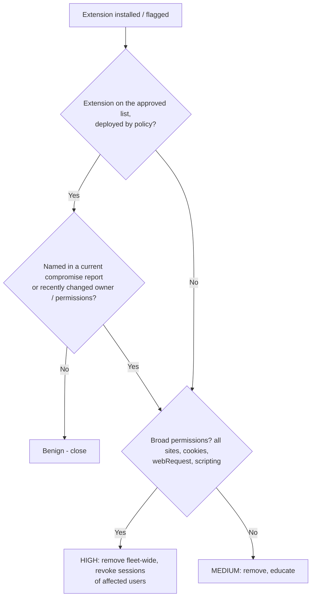

# Malicious or Hijacked Browser Extension

> Extensions can read every page and cookie the user sees. Attackers sideload them, or **compromise legitimate extensions through their developers' accounts** and push a malicious update to all users (several such campaigns hit popular extensions in late 2024). The result is session theft, AiTM proxying and data capture inside the browser, where EDR sees little.

## When this fires
- `win_browser_extension_side_loaded` / `browser-extension-installed-by-non-browser`: an extension installed by a process other than the browser, via `--load-extension`, or by registry or policy changes not made by IT
- Hunt: a known-compromised extension ID appears in a threat report and you need to scope it

## Triage decision tree


## Investigation steps
1. How and where the extension was installed:
   ```kql
   DeviceProcessEvents
   | where TimeGenerated > ago(7d)
   | where ProcessCommandLine has "--load-extension" or ProcessCommandLine has "--remote-debugging-port"
   | project TimeGenerated, DeviceName, AccountName, FileName, ProcessCommandLine, InitiatingProcessFileName
   ```
   For fleet inventory, use Defender Vulnerability Management browser-extension inventory or your browser management console, then search by extension ID.
2. Review the extension manifest: permissions (`<all_urls>`, `cookies`, `webRequest`, `scripting`), update URL (off-store?), and publisher changes.
3. Network: connections from the browser to domains the extension contacts (check the code for hard-coded endpoints).
4. Scope the impact: which users had it while signed in to SaaS or admin consoles? Treat their sessions as exposed.

## True vs false positive

| Points to attack | Points to benign |
|---|---|
| Installed via `--load-extension` from `%APPDATA%` by a non-browser process | Pushed by Intune / GPO from the approved list |
| Extension listed in a supply-chain compromise advisory | Store extension with a stable publisher and narrow permissions |
| `--remote-debugging-port` started by an unknown process (cookie theft) | Developer debugging on a dev machine, documented |

## Containment & response
- Remove the extension (policy blocklist by ID), close and reset browser profiles where needed, and revoke sessions for affected users.
- Move to an **allowlist-only** extension policy (Chrome / Edge `ExtensionInstallAllowlist` with blocklist `*`).
- Monitor the allowlist for ownership or permission changes on updates.

## Escalation criteria
Credential or session theft confirmed, admin users affected, or the extension is fleet-wide → IR.

## Evidence to collect
Extension ID, version, manifest and files; install events; affected user list; network indicators.
