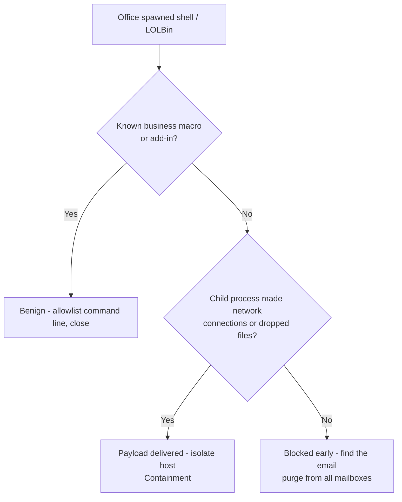

# Malicious Office Document / Phishing Execution

> Office spawning a shell or a LOLBin fetching a remote payload is how most phishing turns into code execution.

## When this fires
- `win_office_spawns_shell` (SecOps): A Microsoft Office application spawned a shell, script host or LOLBin
- `win_lolbin_remote_payload` (SecOps): Signed Windows binaries abused to fetch or execute remote payloads: regsvr32 scriptlet (Squiblydoo), mshta/rundll32 with URLs or javascript:, certutil -urlcache, and…
- `win_execution_from_suspicious_folder` (SecOps): An executable launched from a folder legitimate software almost never runs from (Recycle Bin, Users\\Public, PerfLogs, Windows\\Fonts, Windows\\Debug, Windows\\Tasks)
- `umb_phishing_blocked` (SecOps): Umbrella blocked phishing domains - a user clicked a phishing link
- `office-spawns-shell` (Sentinel): Word, Excel, PowerPoint or Outlook launched cmd, PowerShell, a script host or a LOLBin
- `lolbin-outbound-connection` (Sentinel): mshta, rundll32, regsvr32, certutil, bitsadmin, msbuild or installutil connecting to a public IP

## Triage decision tree

## Investigation steps
1. Identify the document: file path in the command line or Office MRU; get its hash.
2. Find the email: sender, subject, recipients, attachment/URL. Who else received it?
3. Child process behaviour: network connections, files dropped (`%AppData%`, `%Temp%`), persistence created.
4. Detonate the document/URL in a sandbox for extra IOCs.

## True vs false positive

| Points to attack | Points to benign |
|---|---|
| WINWORD / EXCEL spawning cmd, PowerShell, mshta, rundll32 or regsvr32 | Add-in that legitimately launches a signed helper (rare, documented) |
| Document from an external first-time sender, macro enabled | Internal finance workbook with a signed macro |
| LOLBin makes an outbound connection to a new domain | Office update or telemetry processes |

## Containment & response
- Isolate the host if a payload ran; block hashes, domains and sender.
- Purge the email from all mailboxes (Exchange/Defender "Soft delete" / Gmail investigation tool).
- Reset the user's credentials if the payload was an infostealer.
- Block macros from the internet (Mark-of-the-Web policy) if not enforced.

## Escalation criteria
Payload executed, C2 observed, or multiple users opened the document → IR.

## Evidence to collect
Email (.eml), document sample + hash, process tree, dropped files, network IOCs, recipient list.
