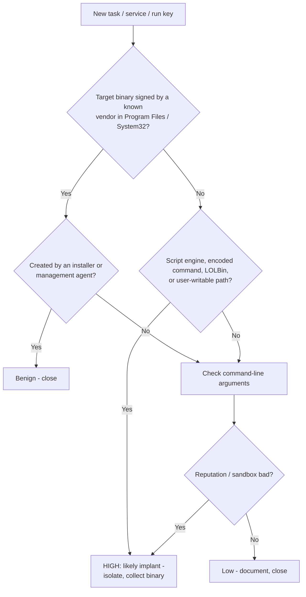

# Persistence via Scheduled Task, Service or Run Key

> The three most common ways to survive a reboot on Windows. Software installers use the same mechanisms every day, so the deciding factor is **what the entry runs and from where**: a signed binary in Program Files is not the same as `powershell -enc` or an exe in `%APPDATA%`.

## When this fires
- `win_schtasks_suspicious_create` / `scheduled-task-suspicious` / `scheduled-task-created-4698`: a task that runs script engines, encoded commands or binaries from user-writable paths
- `win_service_created_suspicious_path` / `service-installed-7045-suspicious-path`: a new service (System 7045 / Security 4697) with an image in Temp, ProgramData, Users, or a `cmd /c` / PowerShell command line
- `win_registry_run_key_persistence` / `run-key-persistence`: Run / RunOnce / Winlogon / IFEO values pointing at suspicious paths

## Triage decision tree


## Investigation steps
1. Show the persistence entry and its creator:
   ```kql
   let host = "<DEVICE_NAME>";
   union
     (DeviceEvents | where ActionType in ("ScheduledTaskCreated", "ServiceInstalled")),
     (DeviceRegistryEvents | where RegistryKey has_any (@"\CurrentVersion\Run", @"\Winlogon", @"\Image File Execution Options"))
   | where TimeGenerated > ago(3d) and DeviceName startswith host
   | project TimeGenerated, ActionType, RegistryKey, RegistryValueName, RegistryValueData, AdditionalFields, InitiatingProcessFileName, InitiatingProcessCommandLine, InitiatingProcessAccountName
   ```
2. Resolve the target binary: path, signer, prevalence in the organization (`DeviceFileCertificateInfo`, global prevalence), and VirusTotal / sandbox verdict.
3. Walk back the creator's process tree to the initial access event (Office macro, browser download, remote logon).
4. Fleet-wide check: has the same task name, service name or run value appeared elsewhere?
5. SecOps pivot:
   ```
   principal.hostname = "<HOST>" AND (metadata.product_event_type = "4698" OR metadata.product_event_type = "7045")
   ```

## True vs false positive

| Points to implant | Points to benign |
|---|---|
| Task runs `powershell -w hidden -enc …` every few minutes | Browser or updater task from a signed vendor |
| Service binary in `C:\ProgramData\<random>\` | Service installed by ConfigMgr with a change |
| Low-prevalence unsigned binary | Binary present on thousands of devices |

## Containment & response
- Isolate if the binary is malicious; collect it and its folder.
- Remove the task, service or registry value **after** collecting evidence, and kill the process.
- Hunt for the same artefacts fleet-wide and block the hash.
- Investigate how the creator gained execution; persistence is rarely the first stage.

## Escalation criteria
Confirmed malicious persistence, privileged (SYSTEM) context, or more than one host → IR.

## Evidence to collect
Task XML / service config / registry export, the target binary and hash, creator process tree, and the timeline.
