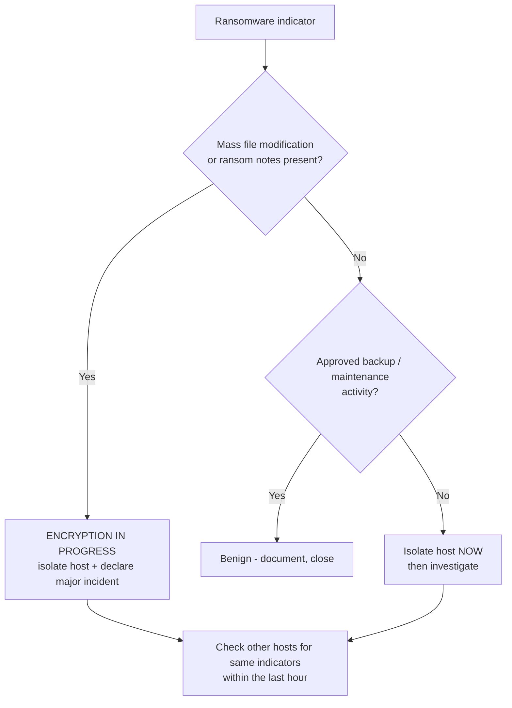

# Ransomware Precursors and Encryption

> Shadow-copy deletion, security tools being killed and mass file changes mean encryption is minutes away or already running. **Contain first, investigate second.**

## Triage decision tree


## Investigation steps (after isolation)
1. Scope: same command lines / hashes / threat names on other hosts:
   ```
   target.process.command_line = /vssadmin|wbadmin|bcdedit|shadowcopy/ nocase
   ```
2. Account used: which user ran the commands? Usually a domain admin or a compromised service account - that account is the attacker's key.
3. Deployment method: GPO, PsExec, scheduled tasks, WMI, RMM tool, or EDR/RMM console abuse.
4. Exfiltration before encryption (double extortion): rclone/MEGA, large outbound transfers.
5. Initial access: VPN brute force, exposed RDP, phishing, unpatched edge device.

## Containment & response
1. Network-isolate affected hosts via EDR; if spreading, isolate segments / disable VPN.
2. Disable the account(s) used for deployment; reset KRBTGT if domain admin was used.
3. Protect backups: take them offline / verify immutability.
4. Do **not** reboot encrypted hosts (keys may be in memory); do not delete ransom notes.

## Escalation criteria
Always a major incident. Notify IR lead, management and legal per the incident response plan.

## Evidence to collect
Ransom note, encrypted file samples, binary hashes, command lines, deployment account, exfil indicators, memory captures.
