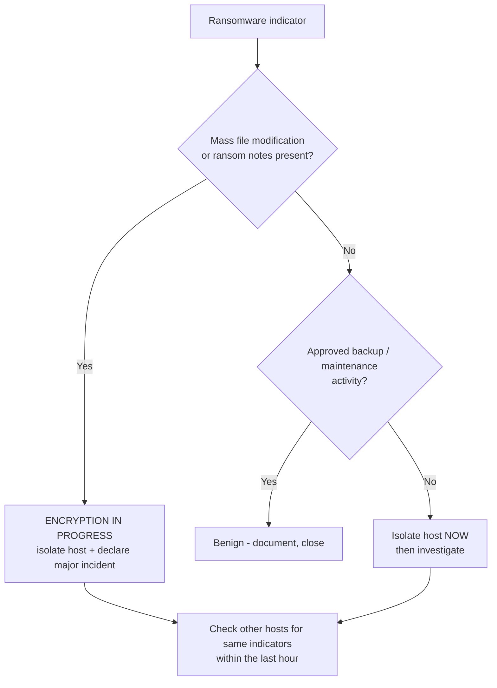

# Ransomware Precursors and Encryption

> Shadow-copy deletion, security tools being killed and mass file changes mean encryption is minutes away or already running. **Contain first, investigate second.**

## When this fires
- `win_inhibit_system_recovery` (SecOps): Deletion of Volume Shadow Copies, backup catalogs or disabling of Windows recovery
- `win_mass_file_modification` (SecOps): A single process modified or renamed 500+ files on one host within 5 minutes - the behavioural signature of ransomware encryption
- `win_security_tool_killed` (SecOps): Attempts to kill or stop security products (Defender, CrowdStrike, SentinelOne, Sophos, ESET ...) via taskkill, sc or Stop-Service
- `win_safe_mode_boot_set` (SecOps): bcdedit forces the next boot into Safe Mode - used by ransomware (REvil, Snatch, BlackCat) to encrypt while security tools are not loaded
- `win_defender_tampering_powershell` (SecOps): Microsoft Defender real-time protection disabled or exclusions added via Set-MpPreference / Add-MpPreference
- `mde_ransomware_alert` (SecOps): Defender alert referencing ransomware behaviour or families
- `edr_same_threat_multiple_hosts` (SecOps): The same threat name detected on 3+ hosts within one hour - an outbreak or active lateral movement
- `shadow-copy-deletion` (Sentinel): vssadmin / wmic / PowerShell deleting shadow copies, wbadmin deleting backups, or bcdedit disabling recovery
- `mass-file-rename` (Sentinel): A single process renames 200+ files on one device within 5 minutes
- `ransom-note-creation` (Sentinel): The same note-like file name (README, DECRYPT, RECOVER, HOW_TO, RESTORE...) written into 20+ folders within 10 minutes
- `backup-files-deleted` (Sentinel): Deletion of backup and VM image files (.vbk, .vib, .vbm, .bak, .tib, .bkf, .vhd(x), .vmdk, .wbcat)
- `security-tool-service-stopped` (Sentinel): net/sc/Stop-Service/taskkill against Defender, EDR agents, backup (Veeam, Acronis, Windows Backup), VSS or SQL writers

## Triage decision tree


## Investigation steps (after isolation)
1. Scope: same command lines / hashes / threat names on other hosts:
   ```
   target.process.command_line = /vssadmin|wbadmin|bcdedit|shadowcopy/ nocase
   ```
2. Account used: which user ran the commands? Usually a domain admin or a compromised service account - that account is the attacker's key.
3. Deployment method: GPO, PsExec, scheduled tasks, WMI, RMM tool, or EDR/RMM console abuse.
4. Exfiltration before encryption (double extortion): rclone/MEGA, large outbound transfers.
5. Initial access: VPN brute force, exposed RDP, phishing, unpatched edge device.

## True vs false positive

| Points to attack | Points to benign |
|---|---|
| `vssadmin delete shadows`, `wbadmin delete catalog`, `bcdedit /set recoveryenabled no` | Backup software pruning its own snapshots |
| Hundreds of renames with a new extension in minutes | Bulk rename by a sync client or document-management migration |
| Security and backup services stopped together | Planned maintenance stopping services with a ticket |

## Containment & response
1. Network-isolate affected hosts via EDR; if spreading, isolate segments / disable VPN.
2. Disable the account(s) used for deployment; reset KRBTGT if domain admin was used.
3. Protect backups: take them offline / verify immutability.
4. Do **not** reboot encrypted hosts (keys may be in memory); do not delete ransom notes.

## Escalation criteria
Always a major incident. Notify IR lead, management and legal per the incident response plan.

## Evidence to collect
Ransom note, encrypted file samples, binary hashes, command lines, deployment account, exfil indicators, memory captures.
