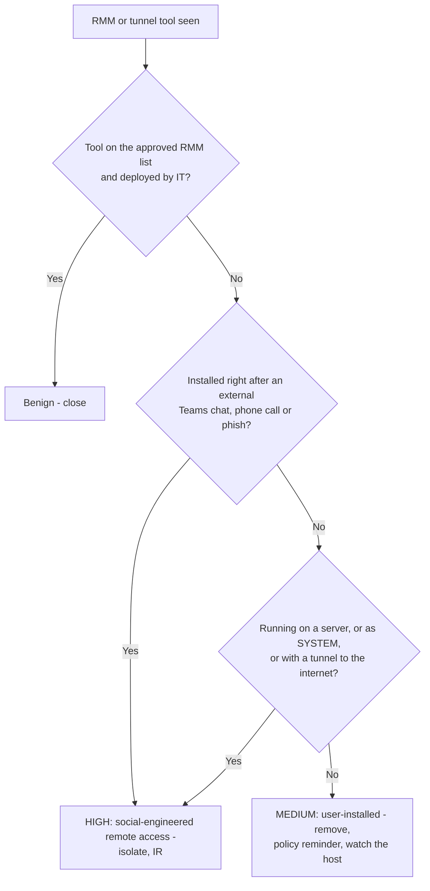

# Remote Access Tool or Tunnel Installed

> AnyDesk, ScreenConnect, TeamViewer, Atera and similar RMM tools, or tunnels such as ngrok, Cloudflared, Chisel and plink, give attackers interactive access that **looks like legitimate IT software** and slips past perimeter controls. They are a staple of ransomware affiliates and helpdesk-vishing scams.

## When this fires
- `win_remote_access_tool` / `dual-use-tools`: execution or install of a remote-management tool not on the approved list
- `win_tunneling_tool` / `consumer-vpn-or-anonymizer`: ngrok, cloudflared, chisel, frp, plink -R, SSH reverse tunnels, or consumer VPN clients

## Triage decision tree


## Investigation steps
1. Find the tool, how it got there, and its outbound connections:
   ```kql
   let host = "<DEVICE_NAME>";
   DeviceProcessEvents
   | where TimeGenerated > ago(3d) and DeviceName startswith host
   | where FileName has_any ("anydesk", "screenconnect", "teamviewer", "atera", "splashtop", "ngrok", "cloudflared", "chisel", "plink", "frpc", "rustdesk")
   | project TimeGenerated, AccountName, FileName, FolderPath, ProcessCommandLine, InitiatingProcessFileName, InitiatingProcessCommandLine
   ```
2. Check the parent: browser download (user-installed), `msiexec` from IT tooling, or a script launched remotely (attacker).
3. Review network connections to the tool's relay domains and the session times. Look at what happened during those sessions (file transfers, new processes).
4. Ask the user whether they were contacted by "IT support". Check the [impersonation](../email/executive-impersonation.md) playbook for an external Teams chat or call.

## True vs false positive

| Points to attack | Points to benign |
|---|---|
| Installed minutes after an external Teams call from "Help Desk" | Corporate RMM deployed via Intune with a known tenant ID |
| Tunnel binary in `%TEMP%` on a server, running as SYSTEM | Developer using ngrok on an approved test laptop |
| Portable exe with no install record | Vendor support session scheduled with a ticket |

## Containment & response
- Isolate the host, terminate the tool and remove it (and any persistence it created).
- Block the tool's relay domains at the proxy or DNS layer, and block unapproved RMM via application control (WDAC / AppLocker).
- Reset credentials used on the host during the session.
- Maintain an approved-RMM list with tenant IDs, and alert on everything else.

## Escalation criteria
Social-engineered install, server or SYSTEM context, or a tunnel exposing internal services → IR.

## Evidence to collect
Install and execution events, tool logs (AnyDesk `ad.trace`, ScreenConnect logs), network connections, user statement, and the session timeline.
