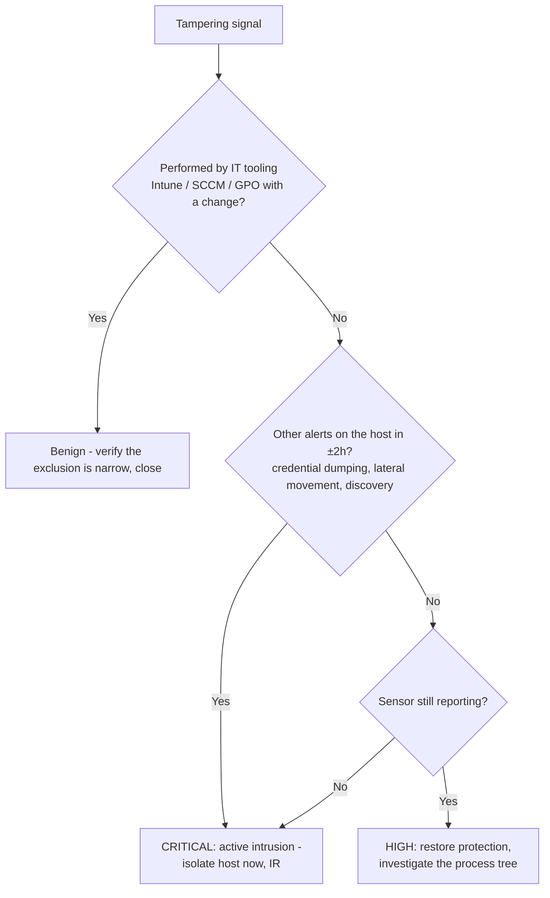

# Security Tool Tampering (EDR / AV Disabled)

> Disabling Defender, killing the EDR sensor or adding broad exclusions is what operators do **right before** they deploy ransomware or run credential theft. Treat tampering as a hands-on-keyboard indicator, not a configuration issue.

## When this fires
- `win_defender_tampering_powershell` / `defender-tampering`: `Set-MpPreference -DisableRealtimeMonitoring`, exclusion paths or extensions added, Defender registry policy keys set
- `win_security_tool_killed` / `security-tool-service-stopped`: EDR / AV processes or services stopped (`sc stop`, `taskkill`, BYOVD killers)
- `mde_tamper_protection_alert`, `cs_sensor_tampering`, `s1_agent_tamper_or_disabled`: the EDR product itself reported a tamper attempt or an offline sensor

## Triage decision tree


## Investigation steps
1. Show what changed and which process changed it:
   ```kql
   let host = "<DEVICE_NAME>";
   union DeviceProcessEvents, DeviceRegistryEvents
   | where TimeGenerated > ago(2d) and DeviceName startswith host
   | where ProcessCommandLine has_any ("Set-MpPreference", "Add-MpPreference", "DisableRealtimeMonitoring", "ExclusionPath", "sc stop", "sc config", "taskkill")
       or RegistryKey has @"\Policies\Microsoft\Windows Defender"
   | project TimeGenerated, ActionType, AccountName, FileName, ProcessCommandLine, RegistryKey, RegistryValueName, RegistryValueData, InitiatingProcessFileName, InitiatingProcessCommandLine
   ```
2. Check **exclusions**: a whole drive, `C:\Users\Public`, `%TEMP%` or `.exe` is attacker-grade. Correlate with files dropped into the excluded path.
3. If the sensor went silent, compare its last check-in with network logs (firewall, DNS) to see what the host did while blind.
4. Look for a vulnerable driver load just before the EDR process died ([BYOVD](vulnerable-driver-byovd.md)).
5. SecOps pivot:
   ```
   principal.hostname = "<HOST>" AND target.process.command_line = /Set-MpPreference|ExclusionPath|DisableRealtimeMonitoring/ nocase
   ```

## True vs false positive

| Points to attack | Points to benign |
|---|---|
| Interactive `powershell.exe` from a user or remote session sets the exclusions | Intune / ConfigMgr agent applies a documented exclusion |
| Broad exclusion, followed by files written to that path | Narrow, vendor-documented exclusion for a database |
| Sensor offline right after other alerts | Planned agent upgrade or uninstall with a ticket |

## Containment & response
- Isolate the host (network isolation via EDR, or a switch port shutdown if the sensor is dead).
- Restore protection and remove exclusions; make sure **tamper protection** is on and managed centrally.
- Hunt across the fleet for the same command line, exclusion path or killer driver.
- Disable the account used and review its activity elsewhere.

## Escalation criteria
Any unauthorized tampering with other suspicious activity, a dead sensor, or the same pattern on multiple hosts → IR (possible pre-ransomware).

## Evidence to collect
Process and registry events, the exclusion list before and after, the sensor health timeline, and the host's network activity while blind.
