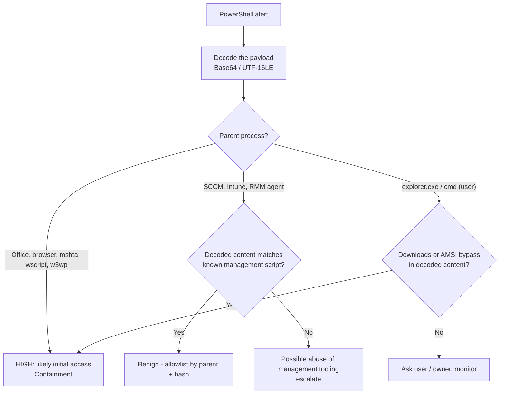

# Suspicious PowerShell Execution

> Encoded commands, download cradles, AMSI bypasses and Defender tampering. Decode first, judge second.

## When this fires
Any rule in `related_rules`. Severity rises when several fire on the same host within minutes.

## Triage decision tree


## Investigation steps
1. **Decode**: `-EncodedCommand` is Base64 of UTF-16LE. In CyberChef: *From Base64 → Decode text (UTF-16LE)*. Repeat for nested layers.
2. Extract IOCs from decoded content: URLs, domains, IPs, file paths, scheduled task names.
3. Process tree - parent and grandparent:
   ```
   metadata.event_type = "PROCESS_LAUNCH" and principal.hostname = "<HOST>"
   ```
4. Network: did the host connect to the extracted domains/IPs?
   ```
   principal.hostname = "<HOST>" and (target.hostname = "<DOMAIN>" or target.ip = "<IP>")
   ```
5. Persistence check: scheduled tasks, Run keys, services created on the host in ±1h.

## True vs false positive
| Likely true positive | Likely false positive |
|---|---|
| Parent is Office / browser / script host | Parent is a signed management agent |
| Decoded content downloads and executes | Decoded content is inventory/config |
| AMSI bypass or Defender exclusions | Runs fleet-wide at the same time daily |
| Connections to new / low-reputation domains | Domain is your own infrastructure |

## Containment & response
- Isolate the host via EDR if a payload executed or C2 is observed.
- Block extracted domains/IPs/hashes; hunt for them fleet-wide.
- Re-enable Defender settings and remove exclusions if tampering occurred.

## Escalation criteria
Payload executed, network connection to attacker infrastructure, AMSI/Defender tampering, or the same activity on more than one host → IR.

## Evidence to collect
Full command line, decoded script, process tree, network connections, dropped files (hashes).
