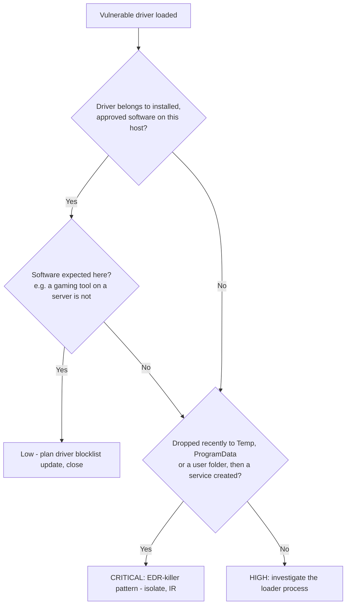

# Vulnerable Driver Loaded (BYOVD)

> "Bring your own vulnerable driver" means loading a signed but exploitable kernel driver (old anti-cheat, hardware or utility drivers) to get kernel access. The attacker then **kills EDR from the kernel**. Ransomware crews use it routinely. A known-vulnerable driver loading on a server is rarely innocent.

## When this fires
- `win_vulnerable_driver_loaded` / `vulnerable-driver-loaded`: a driver load (Sysmon 6, `DeviceEvents` DriverLoad) whose hash or name matches known-vulnerable driver lists (for example LOLDrivers), or a new kernel service from a user-writable path

## Triage decision tree


## Investigation steps
1. Show the driver, its path and the service created to load it:
   ```kql
   let host = "<DEVICE_NAME>";
   DeviceEvents
   | where TimeGenerated > ago(2d) and DeviceName startswith host and ActionType in ("DriverLoad", "ServiceInstalled")
   | project TimeGenerated, ActionType, FileName, FolderPath, SHA256, InitiatingProcessFileName, InitiatingProcessCommandLine, AdditionalFields
   ```
2. Check the hash against the LOLDrivers project and the Microsoft vulnerable driver blocklist.
3. Look at what happened next on the host: security tools stopped, LSASS access, ransomware precursors ([tampering](security-tool-tampering.md), [ransomware](ransomware-precursor.md)).
4. Find the dropper: `sc create … type= kernel`, `fltmc`, or a loader exe in the same folder.

## True vs false positive

| Points to attack | Points to benign |
|---|---|
| Driver written minutes before load by an unsigned process | Driver installed by the vendor MSI years ago |
| Kernel service created from `C:\Users\…` or `C:\ProgramData` | Hardware utility on an engineer's workstation |
| EDR process ends right after | No other suspicious activity |

## Containment & response
- Isolate the host; assume EDR visibility is degraded and use network telemetry for scope.
- Delete the driver and service; reimage if the kernel was compromised.
- Enable the **Microsoft vulnerable driver blocklist** (HVCI / Smart App Control, or WDAC policy) and the ASR rule *Block abuse of exploited vulnerable signed drivers*.
- Hunt the hash and service name fleet-wide.

## Escalation criteria
Any non-approved vulnerable driver on a server, or a load followed by security-tool termination → IR.

## Evidence to collect
Driver file and hash, service creation event, loader process tree, and subsequent host activity.
