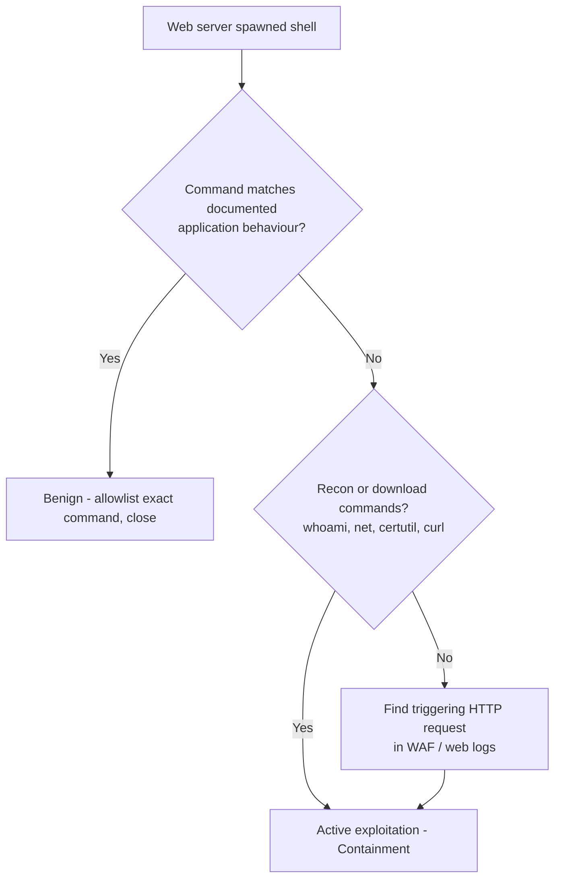

# Web Shell / Exploited Web Application

> A web server process launching `cmd`, `whoami` or `bash` means someone is executing commands through your application.

## Triage decision tree


## Investigation steps
1. Find the triggering request: correlate the process timestamp with web/WAF logs for the same host (URI, source IP, user agent).
   ```
   metadata.event_type = "NETWORK_HTTP" and target.hostname = "<SITE>"
   ```
2. Look for new or recently modified script files in the web root (`.aspx`, `.php`, `.jsp`) - that's the web shell.
3. Identify the vulnerability: known CVE for the product/version (Exchange, Confluence, MOVEit, Ivanti ...)?
4. Post-exploitation: credential dumping, new accounts, lateral movement from the server.

## Containment & response
- Take the application offline or block the attacker IPs at the WAF; isolate the server if post-exploitation occurred.
- Remove the web shell (after collecting it), patch the vulnerability.
- Rotate credentials stored on the server (app config, connection strings, service accounts).

## Escalation criteria
Always IR when commands executed. Internet-facing systems = potential data breach notification.

## Evidence to collect
Web shell file, web/WAF logs, process tree, attacker IPs, vulnerability details.
