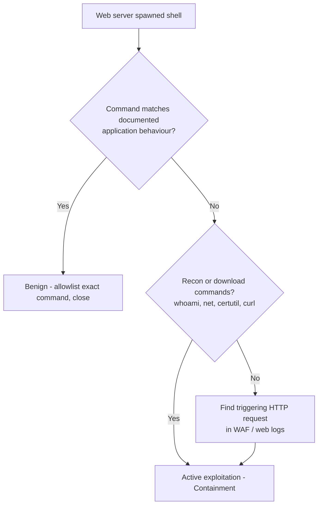

# Web Shell / Exploited Web Application

> A web server process launching `cmd`, `whoami` or `bash` means someone is executing commands through your application.

## When this fires
- `win_webserver_spawns_shell` (SecOps): An IIS / Exchange / web server worker process spawned a shell or recon tool - the hallmark of a web shell or exploited web application (ProxyShell, ProxyLogon, file…
- `lnx_webserver_spawns_shell` (SecOps): Apache / nginx / PHP-FPM / Tomcat spawned a shell or recon tool - web shell or RCE exploitation
- `web_webshell_access` (SecOps): Successful (HTTP 200) requests to common web shell names or command parameters (cmd.php, c99, r57, wso, b374k, ?cmd=)
- `web_command_injection` (SecOps): OS command injection payloads in the URL (;id, |whoami, $(curl ...), backticks)
- `win_sqlserver_spawns_shell` (SecOps): sqlservr.exe spawned a shell - xp_cmdshell or a malicious CLR/Agent job is executing OS commands from the database engine
- `webserver-spawns-shell` (Sentinel): w3wp, Exchange UMWorkerProcess, Tomcat/Java, httpd, nginx, PHP or sqlservr launched cmd, PowerShell, whoami or a LOLBin
- `webshell-file-written` (Sentinel): IIS (w3wp), Apache, nginx, Tomcat or PHP wrote a .aspx/.asp/.php/.jsp/.jspx/.ashx file

## Triage decision tree


## Investigation steps
1. Find the triggering request: correlate the process timestamp with web/WAF logs for the same host (URI, source IP, user agent).
   ```
   metadata.event_type = "NETWORK_HTTP" and target.hostname = "<SITE>"
   ```
2. Look for new or recently modified script files in the web root (`.aspx`, `.php`, `.jsp`) - that's the web shell.
3. Identify the vulnerability: known CVE for the product/version (Exchange, Confluence, MOVEit, Ivanti ...)?
4. Post-exploitation: credential dumping, new accounts, lateral movement from the server.

## True vs false positive

| Points to attack | Points to benign |
|---|---|
| w3wp / httpd / tomcat spawning cmd, sh or whoami | Application that legitimately runs a documented helper binary |
| New .aspx / .jsp / .php written into the web root outside a deploy | File written by the CI/CD deployment account during a release |
| Web requests to a new script from few IPs with POST bodies | Health-check endpoint polled by a load balancer |

## Containment & response
- Take the application offline or block the attacker IPs at the WAF; isolate the server if post-exploitation occurred.
- Remove the web shell (after collecting it), patch the vulnerability.
- Rotate credentials stored on the server (app config, connection strings, service accounts).

## Escalation criteria
Always IR when commands executed. Internet-facing systems = potential data breach notification.

## Evidence to collect
Web shell file, web/WAF logs, process tree, attacker IPs, vulnerability details.
