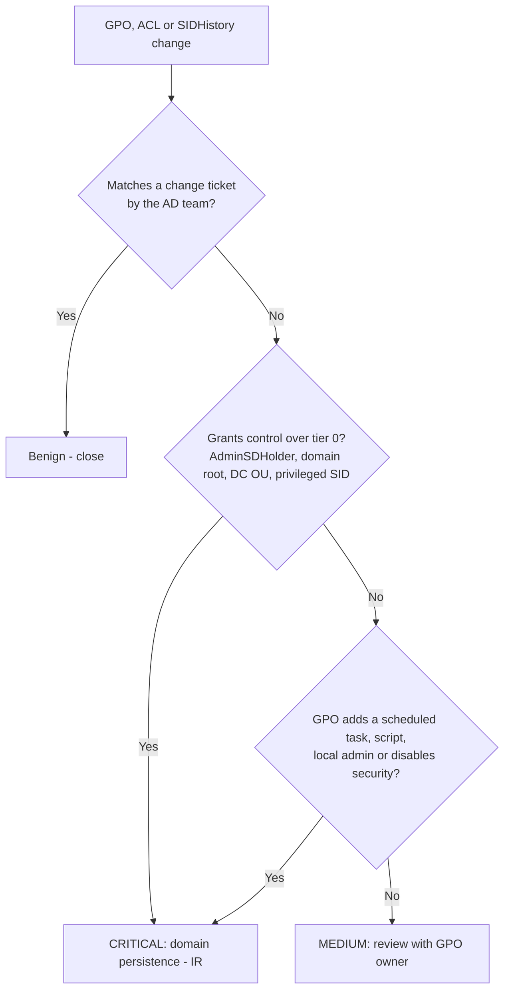

# AD Persistence (ACL, AdminSDHolder, GPO, SIDHistory)

> After getting domain admin, attackers plant backdoors that survive password resets: a **GenericAll ACE on AdminSDHolder** (re-applied to every protected group hourly), a **malicious GPO** that runs code on every machine, or a privileged **SIDHistory** on a normal-looking user. These are the reasons "we reset the DA password" does not end an incident.

## When this fires
- `win_gpo_modified` / `gpo-modified`: a Group Policy object changed (5136 on `groupPolicyContainer`, or SYSVOL changes)
- `win_hidden_account_created`, `win_new_account_then_privileged_group` / `new-account-added-to-privileged-group`: accounts created and quickly privileged, or hidden ($) accounts
- Hunt below: ACL changes on AdminSDHolder and domain root, and SIDHistory additions (4765 / 4766)

## Triage decision tree


## Investigation steps
1. Security-descriptor and attribute changes on high-value objects:
   ```kql
   SecurityEvent
   | where TimeGenerated > ago(30d) and EventID in (5136, 4662, 4765, 4766, 4739)
   | where EventData has_any ("AdminSDHolder", "nTSecurityDescriptor", "sIDHistory", "groupPolicyContainer", "gPLink")
       or EventID in (4765, 4766)
   | project TimeGenerated, Computer, EventID, SubjectUserName, EventData
   ```
2. For GPO changes, diff the GPO (`Get-GPOReport` before and after, or the SYSVOL files). Look for immediate scheduled tasks, startup scripts, *Restricted Groups* adding members, or settings that disable Defender or the firewall.
3. Run an ACL snapshot of AdminSDHolder and the domain root (`Get-Acl "AD:CN=AdminSDHolder,CN=System,DC=…"`) and compare with your baseline. BloodHound highlights unexpected `GenericAll` / `WriteDacl` / `DCSync` edges.
4. SIDHistory: any user whose SIDHistory contains a privileged SID (-512, -519, -544) from the same domain is a backdoor.

## True vs false positive

| Points to attack | Points to benign |
|---|---|
| A normal user granted GenericAll on AdminSDHolder | Delegation change made by the AD team with a ticket |
| GPO linked to the DC OU that creates a task running from a share | Planned security-baseline GPO update |
| SIDHistory with a same-domain privileged SID | Domain migration (ADMT) with documented SIDHistory |

## Containment & response
- Revert the ACE / GPO / SIDHistory from a known-good baseline (backups or snapshot), and remove rogue accounts.
- Treat as domain compromise: reset krbtgt twice, reset privileged accounts, and review every tier-0 object ([DCSync](domain-replication-dcsync.md)).
- Monitor tier-0 changes continuously (Defender for Identity, or 5136 auditing with alerts), and review AD ACLs quarterly.

## Escalation criteria
Any unapproved change that grants control over tier 0 → IR immediately.

## Evidence to collect
5136 / 4765 / 4766 events, GPO reports and SYSVOL files, ACL snapshots before and after, actor's logon history.
