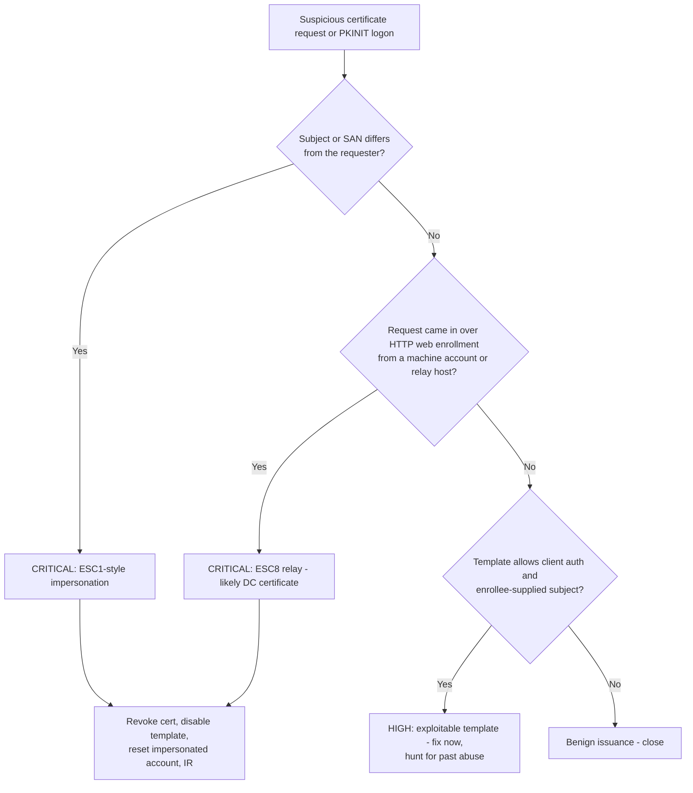

# AD CS Certificate Abuse (ESC1 / ESC8)

> A misconfigured certificate template (ESC1: the requester can supply the subject) or NTLM relay to web enrollment (ESC8) lets a regular user obtain a certificate **as a Domain Admin or a domain controller**. The certificate keeps working after password resets, for its whole validity period. Few SOCs collect CA logs, so this is usually found by hunting.

## When this fires
No dedicated rule in the libraries yet. This playbook is **hunt-driven**. Run the hunts below weekly, and immediately after any Certipy, Certify or PetitPotam indicator. It needs **CA auditing** (certsrv "Issue and manage certificate requests", events 4886/4887) and DC Kerberos events (4768).

## Triage decision tree


## Investigation steps
1. Find issued certificates where the request carried a SAN (the ESC1 pattern):
   ```kql
   SecurityEvent
   | where TimeGenerated > ago(30d) and EventID in (4886, 4887)
   | extend Xml = parse_xml(EventData)
   | mv-apply D = Xml.EventData.Data on (
       summarize Requester = take_anyif(tostring(D["#text"]), tostring(D["@Name"]) == "Requester"),
                 Attributes = take_anyif(tostring(D["#text"]), tostring(D["@Name"]) == "Attributes"),
                 Subject = take_anyif(tostring(D["#text"]), tostring(D["@Name"]) == "Subject"),
                 RequestId = take_anyif(tostring(D["#text"]), tostring(D["@Name"]) == "RequestId"))
   | where Attributes has_any ("SAN:", "upn=", "dns=")
   | project TimeGenerated, Computer, EventID, RequestId, Requester, Subject, Attributes
   ```
2. Find certificate-based Kerberos logons (PKINIT) for privileged accounts. 4768 events show certificate fields when a certificate was used:
   ```kql
   SecurityEvent
   | where TimeGenerated > ago(30d) and EventID == 4768
   | where EventData has "CertIssuerName" and not(EventData has "<Data Name=\"CertIssuerName\"></Data>")
   | project TimeGenerated, Computer, TargetUserName, IpAddress, EventData
   ```
   Compare `TargetUserName` with who actually holds smart cards or Windows Hello for Business. A Domain Admin authenticating with a certificate from a workstation IP is the finding.
3. Enumerate vulnerable templates (`certipy find -vulnerable`, or Locksmith / PSPKIAudit run by the AD team): enrollee-supplied subject together with client-authentication EKU and broad enrollment rights.
4. Look for the tooling on endpoints: `Certify.exe`, `certipy`, `certreq -attrib "SAN:…"`, or `.pfx` files written to user folders.

## True vs false positive

| Points to attack | Points to benign |
|---|---|
| Requester `jdoe` and SAN `administrator@corp` | Web server template where the SAN is the server's own DNS name |
| PKINIT logon as a DA from a workstation | Smart-card logon by the account owner |
| Web-enrollment request from a DC machine account via a non-DC IP | Autoenrollment by machines for their own names |

## Containment & response
- **Revoke the issued certificates** (`certutil -revoke <serial>`) and publish a new CRL. A password reset does **not** invalidate them.
- Disable or fix the vulnerable template: remove *Supply in the request*, require manager approval, and narrow enrollment rights.
- ESC8: disable HTTP web enrollment, or require HTTPS with Extended Protection for Authentication; enforce SMB / LDAP signing.
- Reset the impersonated account, and treat it as domain compromise if a DA or DC certificate was issued ([DCSync](domain-replication-dcsync.md)).
- Make sure the strong certificate mapping enforcement introduced by Microsoft's 2022 certificate-based authentication changes (KB5014754) is enabled on DCs.

## Escalation criteria
Any certificate issued for a different, privileged identity, or any ESC8 relay → IR immediately (tier-0 incident).

## Evidence to collect
CA database export for the request IDs, 4886/4887/4768 events, template configuration, and endpoint timeline of the requester.
