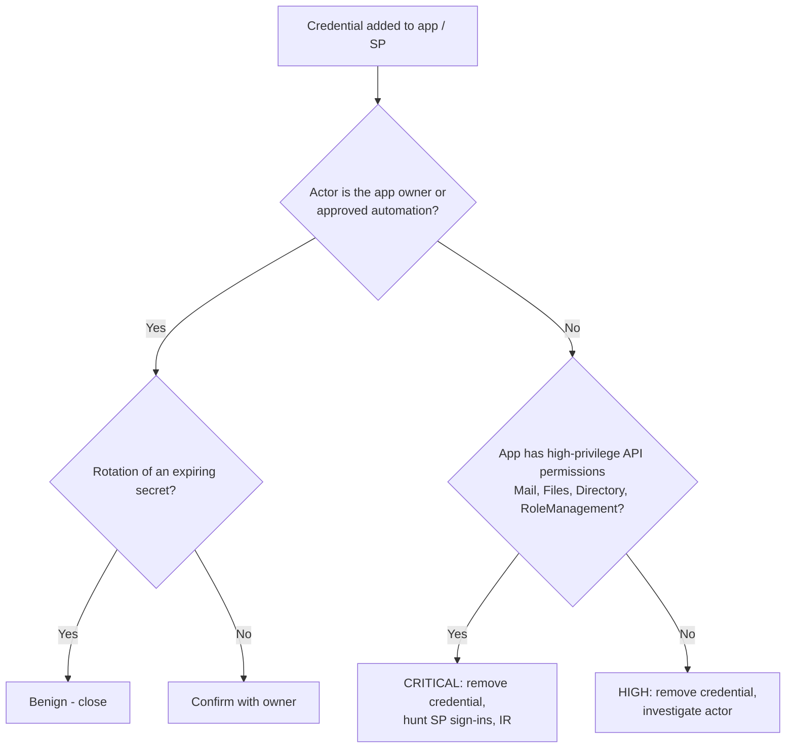

# App / Service Principal Credential Backdoor

> Adding a secret, certificate or federated credential to an existing, already-privileged application gives the attacker **non-interactive access that survives password resets and MFA**. They sign in as the app, not as a user.

## When this fires
- `entra_sp_credentials_added` / `entra-app-credential-added`: `Add service principal credentials` or `Update application – Certificates and secrets management`
- `entra_federated_credential_added` / `entra-managed-identity-federated-credential`: a federated identity credential (GitHub Actions, Kubernetes or an external OIDC issuer) added to an app or managed identity

## Triage decision tree


## Investigation steps
1. Identify the actor, the target app and the credential type.
   ```kql
   AuditLogs
   | where TimeGenerated > ago(7d)
   | where OperationName in ("Add service principal credentials", "Update application – Certificates and secrets management", "Add federated identity credential")
   | extend Actor = coalesce(tostring(InitiatedBy.user.userPrincipalName), tostring(InitiatedBy.app.displayName)),
            ActorIP = tostring(InitiatedBy.user.ipAddress), App = tostring(TargetResources[0].displayName),
            AppId = tostring(TargetResources[0].id)
   | project TimeGenerated, OperationName, Actor, ActorIP, App, AppId, Result
   ```
2. Check what the app can do: Microsoft Graph application permissions, directory roles held by the service principal, and Azure RBAC assignments.
3. Check whether the new credential was used. Look for service-principal sign-ins from new IPs after the change:
   ```kql
   let app = "<APP_ID>";
   AADServicePrincipalSignInLogs
   | where TimeGenerated > ago(7d) and AppId == app
   | summarize SignIns = count(), Resources = make_set(ResourceDisplayName, 20), First = min(TimeGenerated)
       by IPAddress, ResultType
   | order by First asc
   ```
4. For federated credentials, check the **issuer and subject**. A subject that points to a repository or cluster the organization does not own is a backdoor.

## True vs false positive

| Points to attack | Points to benign |
|---|---|
| Actor is a user who has never managed this app | Pipeline or IaC identity rotating secrets on schedule |
| App holds `Mail.Read`, `Files.ReadWrite.All`, `RoleManagement.ReadWrite.Directory` | Low-privilege app owned by the actor's team |
| SP sign-ins from hosting providers right after the change | Credential added and used only from known runners |

## Containment & response
- Delete the added credential (keep its keyId for hunting) and revoke active tokens by rotating the remaining credentials.
- If privileged and used: review every Graph and ARM call made by the SP since the change, and treat accessed mailboxes and files as exposed.
- Restrict who can manage app credentials (owners, Application Administrator), and alert on owner additions.
- Prefer managed identities and certificate credentials with short lifetimes.

## Escalation criteria
A privileged app, use of the credential from unknown infrastructure, or an actor that is itself suspicious → IR.

## Evidence to collect
AuditLogs entries (with keyId), SP sign-in logs, the app's permission and role inventory, and the actor's activity timeline.
