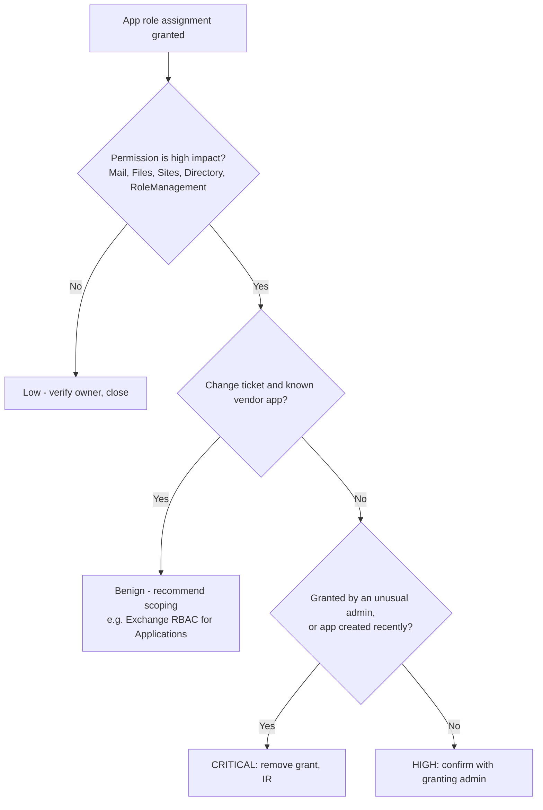

# Application Permission (App-Only) Granted

> An admin consented to an **application permission**, for example `Mail.Read`, `Files.Read.All` or `Directory.ReadWrite.All`. Unlike user consent, app-only permissions act on **every user in the tenant** without anyone signing in. One grant can expose every mailbox.

## When this fires
- `entra_app_only_permission_granted` / `entra-app-only-permission-granted`: `Add app role assignment to service principal` on Microsoft Graph or Exchange Online with a high-impact role

## Triage decision tree


## Investigation steps
1. Show which permission was granted, to which app, and by whom.
   ```kql
   AuditLogs
   | where TimeGenerated > ago(7d) and OperationName == "Add app role assignment to service principal"
   | extend Actor = coalesce(tostring(InitiatedBy.user.userPrincipalName), tostring(InitiatedBy.app.displayName)),
            Props = TargetResources[0].modifiedProperties
   | mv-expand Props
   | where tostring(Props.displayName) in ("AppRole.Value", "ServicePrincipal.DisplayName")
   | summarize Values = make_set(tostring(Props.newValue)) by TimeGenerated, Actor, CorrelationId
   ```
2. Check how old the app is and who created it. An app registered in the last few days plus an immediate high-impact grant is the classic pattern.
3. Find credentials on the app (secrets or certificates added recently: see [App credential backdoor](app-credential-backdoor.md)).
4. Review what the service principal did after the grant (Graph activity and mailbox access). In SecOps:
   ```
   metadata.product_name = "Office 365" AND principal.user.userid = "<APP_ID>"
   ```

## True vs false positive

| Points to attack | Points to benign |
|---|---|
| App registered recently, multi-tenant, with an unverified publisher | Known backup, archiving or email-security vendor |
| Grant by an admin outside normal hours or from a new IP | Grant via an approved change by the M365 team |
| Secret added to the app minutes before or after | No credentials beyond the vendor's own |

## Containment & response
- Remove the app role assignment, and disable the service principal if it is unknown.
- Rotate or delete its credentials; review mailbox and file access by the SP since the grant.
- Restrict admin consent with the admin consent workflow and limit who holds Privileged Role Administrator / Cloud Application Administrator.
- For legitimate mail apps, scope access with **Exchange RBAC for Applications** (or application access policies) instead of tenant-wide `Mail.Read`.

## Escalation criteria
Unknown app, unusual granting admin, or evidence of data access by the SP → IR.

## Evidence to collect
AuditLogs grant record, app registration details (creation time, publisher, owners, credentials), SP sign-ins and data-access logs.
