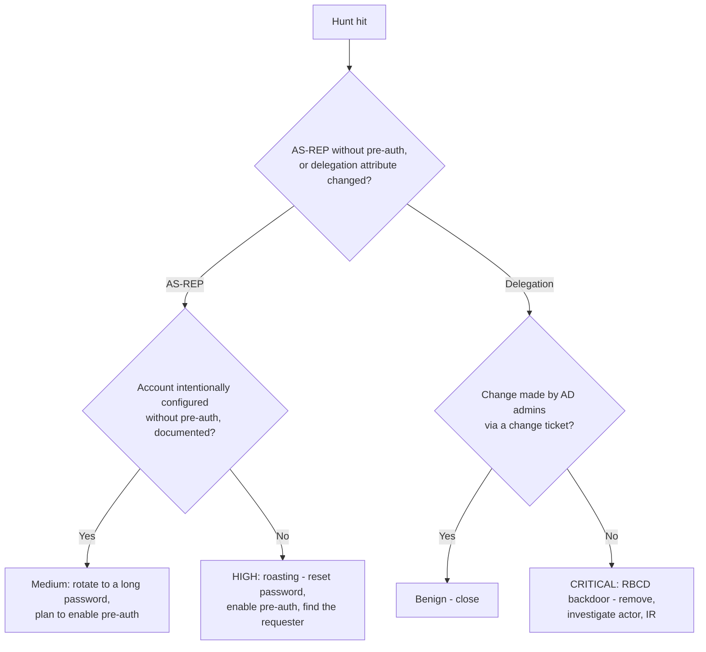

# AS-REP Roasting and Kerberos Delegation Abuse

> Accounts with **"Do not require Kerberos pre-authentication"** hand out crackable AS-REPs to anyone who asks. **Resource-based constrained delegation (RBCD)** written onto a computer object lets an attacker impersonate any user to that machine. Both are quiet, built-in features, so they are found by hunting.

## When this fires
**Hunt-driven.** Run weekly. It needs 4768 on DCs, and *Audit Directory Service Changes* (5136) for the delegation hunt.

## Triage decision tree


## Investigation steps
1. AS-REP requests with no pre-authentication (PreAuthType 0):
   ```kql
   SecurityEvent
   | where TimeGenerated > ago(7d) and EventID == 4768
   | extend Xml = parse_xml(EventData)
   | mv-apply D = Xml.EventData.Data on (
       summarize PreAuth = take_anyif(tostring(D["#text"]), tostring(D["@Name"]) == "PreAuthType"),
                 Etype = take_anyif(tostring(D["#text"]), tostring(D["@Name"]) == "TicketEncryptionType"))
   | where PreAuth == "0"
   | summarize Requests = count(), Sources = make_set(IpAddress, 20) by TargetUserName, Etype
   ```
2. Delegation changes on computer and user objects:
   ```kql
   SecurityEvent
   | where TimeGenerated > ago(30d) and EventID == 5136
   | where EventData has_any ("msDS-AllowedToActOnBehalfOfOtherIdentity", "msDS-AllowedToDelegateTo", "userAccountControl")
   | project TimeGenerated, Computer, SubjectUserName, EventData
   ```
3. Inventory exposure with the AD team: accounts with `DONT_REQ_PREAUTH`, unconstrained delegation on non-DCs, and constrained delegation to sensitive SPNs (`ldap`, `cifs` on DCs).
4. For any RBCD write: who wrote it, and was the principal added a computer account the attacker created (4741, `ms-DS-MachineAccountQuota`)?

## True vs false positive

| Points to attack | Points to benign |
|---|---|
| Many no-pre-auth AS-REPs requested from one workstation | One legacy Unix integration account, known and documented |
| RBCD written by a normal user or a fresh computer account | Delegation configured by AD admins for a documented app |
| Followed by S4U service tickets (4769) to the target | No ticket activity after the change |

## Containment & response
- Enable pre-authentication; reset affected passwords (25+ random characters).
- Remove unexpected RBCD / delegation entries and delete attacker-created computer accounts.
- Set `ms-DS-MachineAccountQuota` to 0, mark admin accounts *Account is sensitive and cannot be delegated*, and add them to Protected Users.
- Remove unconstrained delegation from everything except DCs.

## Escalation criteria
Unapproved delegation change, or roasting of privileged accounts → IR.

## Evidence to collect
4768 / 4769 / 5136 / 4741 events, attribute values before and after, the requesting host's timeline.
