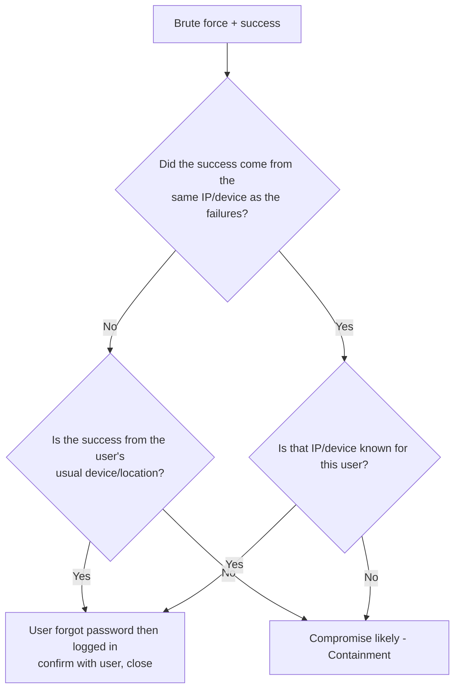

# Brute Force Followed by Successful Login

> Many failures, then a success for the same account. Assume the account is compromised until proven otherwise.

## When this fires
- `auth_bruteforce_then_success` - 10+ failures then success within 1h
- `win_rdp_bruteforce`, `lnx_ssh_bruteforce` - host-level brute force (check for a later success)
- `entra-bruteforce-then-success` (Sentinel): 10+ failures for one account followed by a success for the same account within an hour
- `entra-bruteforce-single-account` (Sentinel): 10 or more failed password attempts against one account within 10 minutes
- `rdp-bruteforce` (Sentinel): 20+ failed logons (4625) from one source to one host in 15 minutes

## Triage decision tree


## Investigation steps
1. Compare `principal.ip`, geo and device of failures vs. the success (rule outcomes `$failure_source_ips`, `$success_source_ips`).
2. Contact the user out-of-band (phone/Teams, **not** email) - did they log in at that time?
3. What happened after login? Search the user's activity for the next 4 hours:
   ```
   principal.user.userid = "<USER>" or target.user.userid = "<USER>"
   ```
   Look for: MFA registration, mailbox rules, file downloads, new OAuth consents, privilege changes, RDP/SSH onward.
4. For RDP/SSH: check processes spawned in the new session on the target host.

## True vs false positive
| Likely true positive | Likely false positive |
|---|---|
| Success from a new country / hosting ASN | Same device, user confirms |
| Post-login MFA registration or inbox rules | Password reset event just before success |
| Failures across many passwords quickly (scripted) | Failures spread over minutes (human typing) |

## Containment & response
1. Disable the account or force password reset **and** revoke all sessions / refresh tokens.
2. Remove attacker-registered MFA methods, OAuth grants, inbox rules.
3. For hosts: isolate via EDR if post-login activity is suspicious.
4. Block the source IP; hunt for the same IP across all users.

## Escalation criteria
Escalate to IR immediately if the user does not confirm the login, the account is privileged, or post-login activity is observed.

## Evidence to collect
Login timeline, IPs/geo, device IDs, post-login actions, user confirmation record.
