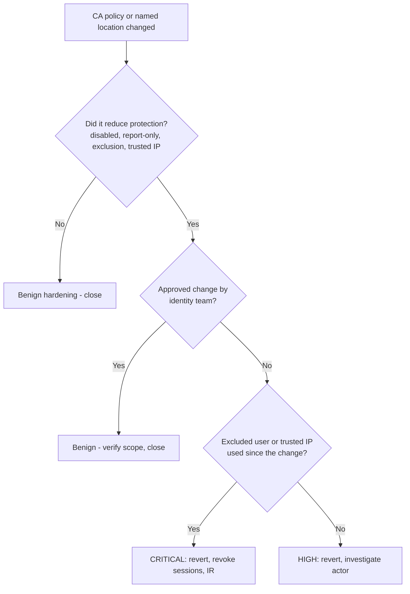

# Conditional Access Policy Weakened

> Attackers with admin rights disable MFA policies, add their IP to a trusted named location, or exclude their account, then come back without MFA. Every Conditional Access change is security-relevant. The question is whether it **reduced protection**.

## When this fires
- `entra_conditional_access_changed` / `entra-conditional-access-changed`: `Add/Update/Delete conditional access policy` or named-location changes in AuditLogs

## Triage decision tree


## Investigation steps
1. Diff the policy: compare old and new values for state, include/exclude users, and locations.
   ```kql
   AuditLogs
   | where TimeGenerated > ago(7d)
   | where OperationName has_any ("conditional access policy", "named location")
   | extend Actor = coalesce(tostring(InitiatedBy.user.userPrincipalName), tostring(InitiatedBy.app.displayName)),
            Policy = tostring(TargetResources[0].displayName),
            OldValue = tostring(TargetResources[0].modifiedProperties[0].oldValue),
            NewValue = tostring(TargetResources[0].modifiedProperties[0].newValue)
   | project TimeGenerated, OperationName, Actor, Policy, OldValue, NewValue
   ```
   Look for `"state":"disabled"` or `"enabledForReportingButNotEnforced"`, new GUIDs under `excludeUsers` / `excludeGroups`, and new CIDR ranges in a trusted location.
2. Check whether an excluded user or a new trusted IP has signed in since the change, and whether MFA was skipped (`AuthenticationRequirement == "singleFactorAuthentication"`).
3. Review the actor: role activation, sign-in risk and source IP for the session that made the change.

## True vs false positive

| Points to attack | Points to benign |
|---|---|
| Exclusion of a single regular user, or a trusted location with a hosting-provider IP | Break-glass account excluded by design (documented) |
| Policy disabled and re-enabled hours later (hiding a window) | New policy created in report-only for testing |
| Actor session is risky or comes from an unfamiliar country | Change made via an IaC pipeline with a pull request |

## Containment & response
- Revert the policy from the previous `oldValue` (or from your CA-as-code baseline).
- Revoke sessions for the excluded accounts and review their activity during the window.
- Require PIM activation with approval for Conditional Access Administrator and Security Administrator.
- Back up CA policies as code and alert on drift.

## Escalation criteria
Unapproved reduction of protection, especially one that was then used → IR.

## Evidence to collect
AuditLogs with old and new values, sign-ins that benefited from the change, and the actor's session details.
