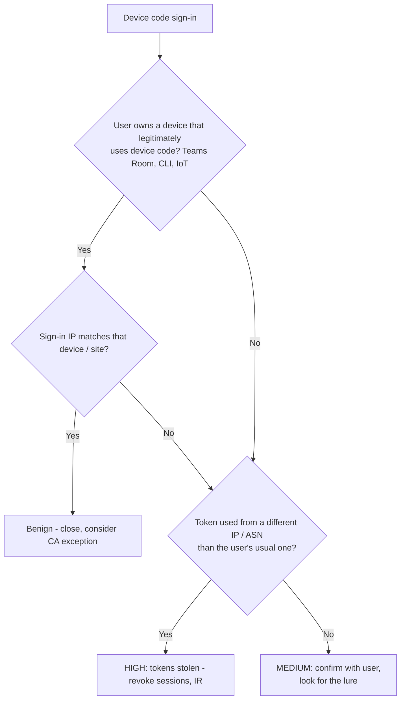

# Device Code Phishing

> The attacker starts a legitimate Microsoft **device-code sign-in** and tricks the victim (via email, Teams or a fake meeting invite) into typing the code at `microsoft.com/devicelogin`. The victim completes real MFA, and **the attacker's device receives the tokens**. There is no fake page and no password theft. This has been used at scale by state-backed actors since 2024–2025.

## When this fires
- `entra_device_code_sign_in` (SecOps): A user signed in with the OAuth device code flow - the flow abused by device code phishing, where the victim completes MFA and the attacker's device receives the tokens
- `entra-device-code-sign-in` (Sentinel): A user completed a sign-in using the OAuth device code flow

**Also hunt** daily: follow each device-code sign-in to the non-interactive token use that comes after it, especially Graph or Exchange access from a different IP than the user's.

## Triage decision tree


## Investigation steps
1. Device-code sign-ins by user and location:
   ```kql
   SigninLogs
   | where TimeGenerated > ago(14d)
   | extend AuthProtocol = tostring(column_ifexists("AuthenticationProtocol", "")),
            TransferMethod = tostring(column_ifexists("OriginalTransferMethod", ""))
   | where AuthProtocol =~ "deviceCode" or TransferMethod =~ "deviceCodeFlow"
   | project TimeGenerated, UserPrincipalName, AppDisplayName, ResourceDisplayName, IPAddress, AutonomousSystemNumber, ResultType, UserAgent
   ```
   `AuthenticationProtocol` and `OriginalTransferMethod` are newer SigninLogs columns. If your workspace returns nothing, confirm they are populated (Entra sign-in logs → Authentication Details).
2. Follow the tokens: non-interactive sign-ins for the same user and app after the event, from IPs that aren't the user's:
   ```kql
   let upn = "<USER_UPN>";
   AADNonInteractiveUserSignInLogs
   | where TimeGenerated > ago(3d) and UserPrincipalName =~ upn and ResultType == "0"
   | summarize First = min(TimeGenerated), Apps = make_set(AppDisplayName, 10) by IPAddress, AutonomousSystemNumber
   | order by First asc
   ```
3. Find the lure: emails or Teams chats in the previous hour containing `devicelogin`, `microsoft.com/devicelogin`, or an 8–9 character code, often disguised as a meeting invite.
4. Check post-compromise actions: mailbox access, Graph searches for "password" / "credentials", new device registration (a primary refresh token, PRT, via device registration).

## True vs false positive

| Points to attack | Points to benign |
|---|---|
| Office user with no CLI or meeting-room device uses device code | Azure CLI `az login --use-device-code` by an engineer |
| Tokens then used from a hosting ASN abroad | Teams Rooms device on the corporate network |
| Preceded by a "Teams meeting" invite from an external sender | Smart TV / kiosk registered by IT |

## Containment & response
- Revoke the user's sessions and refresh tokens; remove any device registered in the window.
- Purge the lure messages and block the sender or external Teams tenant.
- **Block the device code flow with Conditional Access (Authentication flows)** for everyone except named exceptions (Teams Rooms, specific admins).
- Review data accessed with the stolen tokens.

## Escalation criteria
Confirmed token use by the attacker, privileged users, or multiple victims → IR.

## Evidence to collect
Sign-in logs (interactive and non-interactive), the lure message, device registrations, post-compromise activity.
