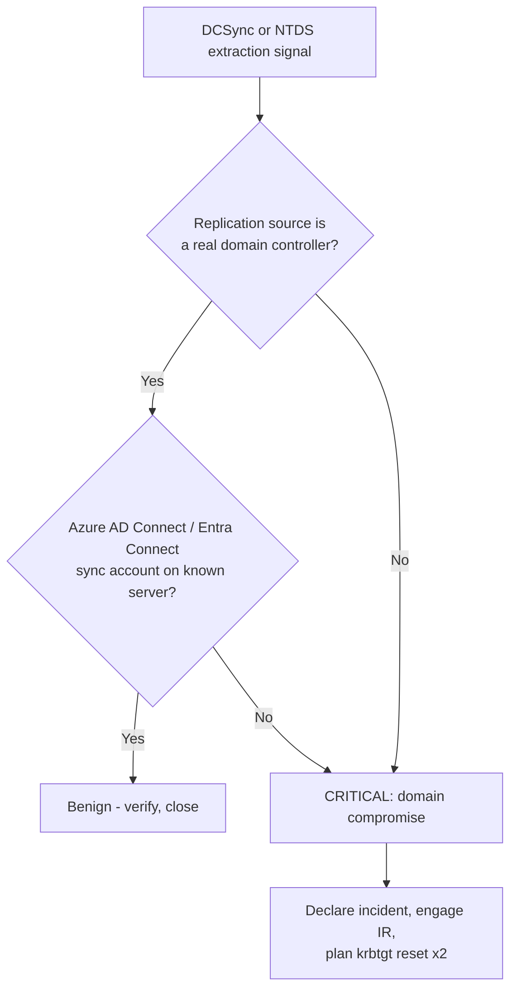

# DCSync / NTDS.dit Theft (Domain Compromise)

> DCSync abuses directory replication rights to pull every password hash, including **krbtgt**, from a domain controller over the network. NTDS.dit theft copies the database file itself. Either way the attacker can forge Golden Tickets. **Assume full domain compromise** until it is disproven.

## When this fires
- `win_dcsync_tooling`: mimikatz `lsadump::dcsync`, impacket `secretsdump`, DSInternals patterns
- `win_ntds_dit_extraction`: `ntdsutil "ac i ntds" ifm`, `vssadmin` / `esentutl` copies of `ntds.dit`, or shadow-copy access on a DC
- `mdi_domain_compromise_alert` / `defender-for-identity-alert`: Defender for Identity raised DCSync, Golden Ticket, DCShadow or skeleton-key alerts

## Triage decision tree


## Investigation steps
1. Find replication requests from non-DCs. Event 4662 with the replication GUIDs `1131f6aa-…` (DS-Replication-Get-Changes) and `1131f6ad-…` (Get-Changes-All):
   ```kql
   SecurityEvent
   | where TimeGenerated > ago(7d) and EventID == 4662
   | where Properties has_any ("1131f6aa-9c07-11d1-f79f-00c04fc2dcd2", "1131f6ad-9c07-11d1-f79f-00c04fc2dcd2")
   | where SubjectUserName !endswith "$"
   | summarize Count = count(), DCs = make_set(Computer) by SubjectUserName, SubjectDomainName
   ```
   A user account (not a DC machine account, and not the documented Entra Connect account) on this list is the finding.
2. Identify the source host (MDI alert evidence, or the 4624 logon on the DC by that account) and pull its EDR timeline.
3. Work out how the attacker got replication rights: membership of Domain Admins / Enterprise Admins / Administrators, or an ACL granting `Replicating Directory Changes All` to an unusual principal.
4. SecOps pivot on the account:
   ```
   principal.user.userid = "<ACCOUNT>" AND metadata.product_event_type = "4662"
   ```

## True vs false positive

| Points to attack | Points to benign |
|---|---|
| Replication from a workstation or member server | Replication between DCs (machine accounts ending in `$`) |
| A regular admin account performing replication | The documented Entra Connect sync account from the sync server |
| `ntdsutil ifm` on a DC with no change ticket | Planned DC promotion / IFM media creation with a ticket |

## Containment & response
- Declare a major incident. Isolate the source host and disable the account used.
- Remove any unusual replication ACLs and privileged group members.
- **Reset krbtgt twice**, at least 10–12 hours apart (longer than the maximum ticket lifetime), using a tested procedure, then reset all privileged and service account passwords.
- Rebuild trust in the tier-0 assets: DCs, AD CS, Entra Connect and PAM. Rotate AD CS and AD FS secrets if they were reachable.

## Escalation criteria
Always escalate to IR and the AD owners immediately.

## Evidence to collect
4662/4624 events from the DCs, MDI alert export, source host image or EDR timeline, privileged group and ACL snapshots, and the krbtgt reset log.
