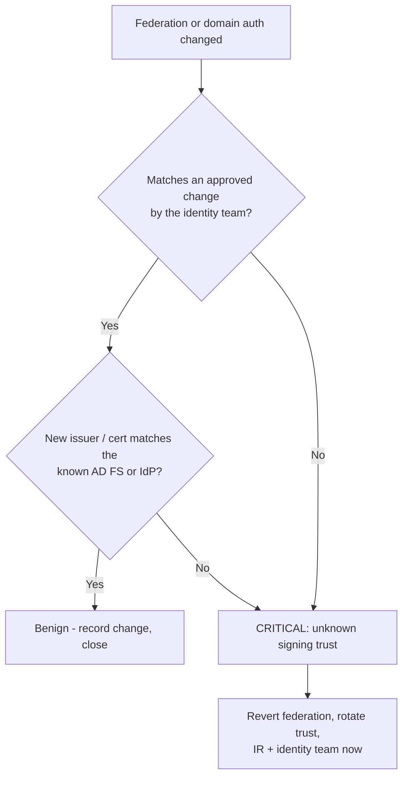

# Federation / Domain Trust Tampering

> Adding a federated domain or changing a domain's token-signing certificate lets an attacker **mint their own SAML tokens for any user**, MFA included (the Golden SAML / "Solorigate" technique). This is tenant-level persistence: treat it as critical until it is proven to be a planned change.

## When this fires
- `entra_federation_settings_changed` / `entra-domain-federation-changed`: `Set federation settings on domain`, `Set domain authentication`, a new or verified domain, or a federation certificate change in AuditLogs

## Triage decision tree


## Investigation steps
1. Pull the exact change: who made it, from where, and the old and new values.
   ```kql
   AuditLogs
   | where TimeGenerated > ago(30d)
   | where OperationName has_any ("federation", "domain authentication", "Add unverified domain", "Verify domain")
   | extend Actor = coalesce(tostring(InitiatedBy.user.userPrincipalName), tostring(InitiatedBy.app.displayName)),
            ActorIP = tostring(InitiatedBy.user.ipAddress), Domain = tostring(TargetResources[0].displayName),
            Changes = TargetResources[0].modifiedProperties
   | project TimeGenerated, OperationName, Actor, ActorIP, Domain, Result, Changes
   ```
2. Check how the actor got in: a sign-in from a new IP, recent role activation (Global Admin, Hybrid Identity Admin) and MFA method changes in the preceding 24 hours.
3. Look for **forged-token use**. These are sign-ins for the affected domain where the federated IdP (AD FS) has no matching authentication event, or where `AuthenticationDetails` shows federated MFA claims for users who never use AD FS.
4. If AD FS is on-prem: check for token-signing certificate export (AD FS event 1007, DKM container reads, `Export-PfxCertificate` on the AD FS server) via EDR.

## True vs false positive

| Points to attack | Points to benign |
|---|---|
| Change made outside a change window by an account that rarely administers domains | Planned migration to or from AD FS / Okta / Ping with a ticket |
| New federated domain or issuer URI nobody recognises | Certificate auto-rollover on the known AD FS farm |
| Actor's session itself risky or new | Change made from the identity team's admin workstation |

## Containment & response
- Revert the domain to **managed** authentication, or restore the known-good federation settings and remove any unknown domain.
- Rotate the AD FS token-signing and token-decrypting certificates twice, so old forged tokens stop validating.
- Revoke sessions for privileged users; review all role assignments, app credentials and Conditional Access changes since the event.
- Remove and investigate the actor account.

## Escalation criteria
Always escalate to IR and the identity owner, unless the change is matched to an approved ticket within minutes.

## Evidence to collect
AuditLogs entries with modifiedProperties, the actor's sign-in history, AD FS server logs and EDR timeline, and certificate thumbprints (old and new).
