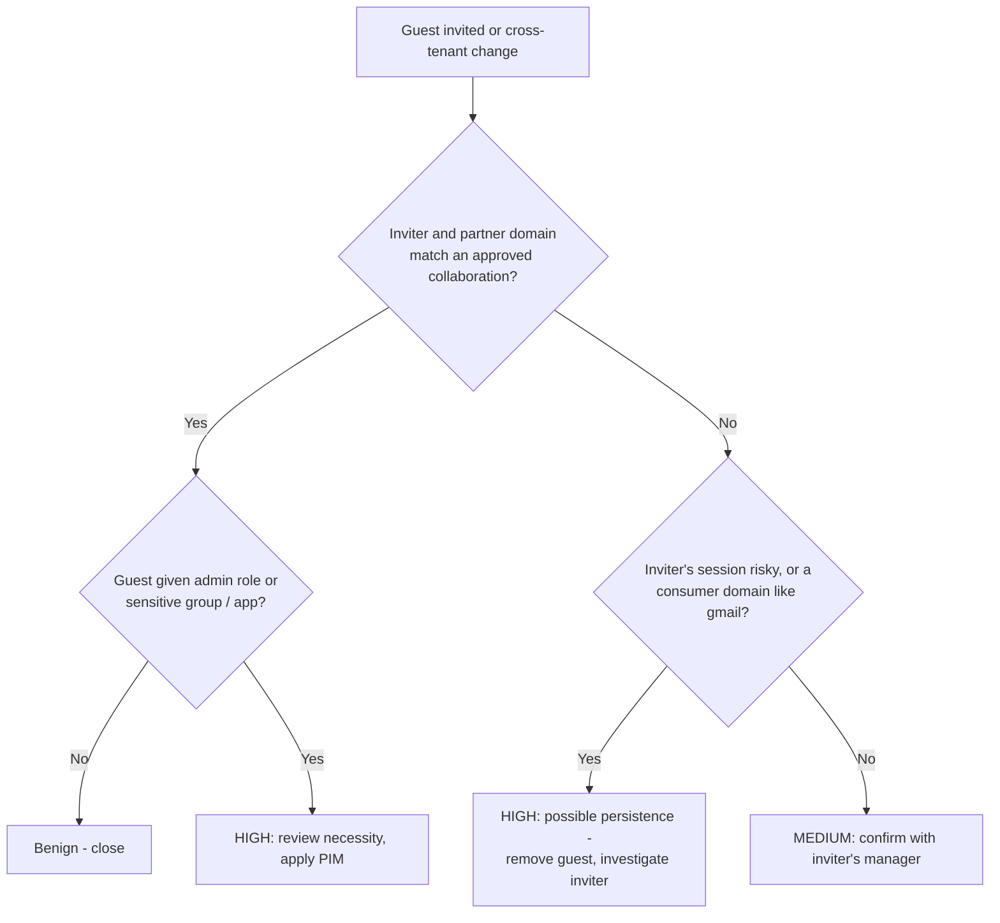

# Guest and Cross-Tenant Access Abuse

> Guest (B2B) accounts and cross-tenant access settings extend trust to identities **you don't manage**. Their MFA, offboarding and device health belong to another organization. Attackers invite their own guests, add guests to privileged groups, or change cross-tenant settings to allow inbound sync from a tenant they control.

## When this fires
- `entra_guest_invited` / `entra-guest-invited-and-privileged`: guest invitations, especially followed by a role or privileged group assignment
- `entra_sensitive_group_member_added` / `entra-group-membership-sensitive`: guests added to sensitive groups
- Hunt below: cross-tenant access policy and cross-tenant sync changes

## Triage decision tree


## Investigation steps
1. Guest invitations and cross-tenant policy changes:
   ```kql
   AuditLogs
   | where TimeGenerated > ago(14d)
   | where OperationName has_any ("Invite external user", "Add user", "cross-tenant", "CrossTenantAccessPolicy", "partner")
   | extend Actor = coalesce(tostring(InitiatedBy.user.userPrincipalName), tostring(InitiatedBy.app.displayName)),
            Target = tostring(TargetResources[0].userPrincipalName), Detail = tostring(TargetResources[0].modifiedProperties)
   | where OperationName has "cross-tenant" or OperationName has "partner" or Target has "#EXT#"
   | project TimeGenerated, OperationName, Actor, Target, Detail
   ```
2. What can the guest reach: group memberships, app assignments, SharePoint sites shared with them, and any directory roles.
3. What has the guest done: sign-ins (home tenant, IP), file access, Teams activity.
4. For cross-tenant sync or inbound trust changes, identify the partner tenant ID and whether anyone recognises it.

## True vs false positive

| Points to attack | Points to benign |
|---|---|
| Guest from a free-mail domain added to a finance group | Partner employee invited by the project owner |
| Inbound cross-tenant trust to an unknown tenant ID | M&A tenant integration with a change ticket |
| Invitation by a user whose own sign-in was risky | Scheduled access review keeps the guest |

## Containment & response
- Remove the guest or block their sign-in; revert cross-tenant access and sync settings.
- Restrict who can invite guests, require MFA for guests via Conditional Access, set guest access to the most restrictive level, and run quarterly access reviews.
- Treat inbound trust settings (MFA / device claims trust) as security changes requiring approval.

## Escalation criteria
Privileged guest access without approval, or a cross-tenant change to an unknown tenant → IR.

## Evidence to collect
AuditLogs invitation and policy events, guest permissions, guest activity logs.
