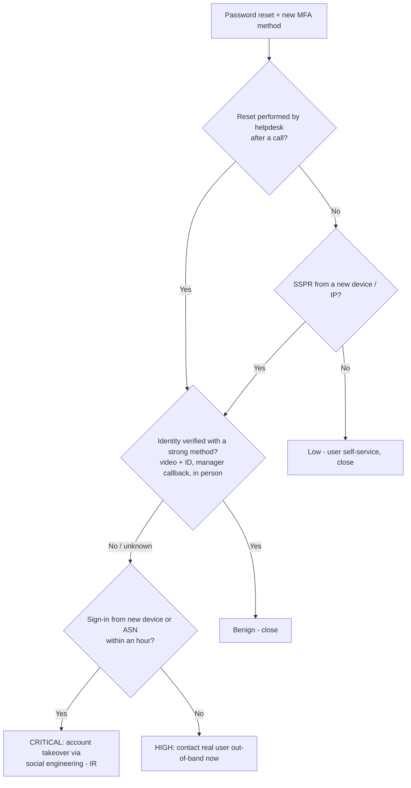

# Helpdesk Social Engineering / MFA Reset Abuse

> The attacker calls the service desk pretending to be an employee (often an admin, sometimes using a cloned voice), gets the password reset and **MFA re-registered to their own phone**, and walks in. This was the signature move behind major 2023–2025 intrusions (Scattered Spider). The logs look like normal helpdesk work. The context is what gives it away.

## When this fires
- `entra_mfa_method_changed`: a new MFA method registered, or methods deleted
- `entra-sspr-abuse`, `entra-privileged-password-reset` / `auth_password_changes_burst`, `entra-many-password-changes`: self-service or helpdesk resets, especially for privileged users

## Triage decision tree


## Investigation steps
1. Reconstruct the reset sequence for the user:
   ```kql
   let upn = "<USER_UPN>";
   AuditLogs
   | where TimeGenerated > ago(3d)
   | where OperationName has_any ("Reset password", "Reset user password", "Register security info", "Delete security info", "User registered security info", "Admin registered security info", "Update user")
   | where tostring(TargetResources[0].userPrincipalName) =~ upn or tostring(InitiatedBy.user.userPrincipalName) =~ upn
   | project TimeGenerated, OperationName, Initiator = coalesce(tostring(InitiatedBy.user.userPrincipalName), tostring(InitiatedBy.app.displayName)),
       InitiatorIP = tostring(InitiatedBy.user.ipAddress), Result
   ```
2. Sign-ins right after the reset: device, IP, ASN, user agent. A first sign-in from a residential proxy or VPS shortly after a helpdesk call is the classic pattern.
3. Pull the helpdesk ticket and call record: caller number, verification steps used, and the agent. Contact the **real user through a known channel** (manager, Teams presence, in person).
4. Check the attacker's next moves: access to Okta / Entra admin portals, VPN, Citrix, SharePoint searches for "VPN", "password", "AWS".

## True vs false positive

| Points to attack | Points to benign |
|---|---|
| Caller pressures for urgency; caller ID doesn't match the HR record | Ticket raised from the user's own device or email |
| New authenticator phone registered minutes after reset | User got a new phone and the ticket says so |
| Privileged account reset by phone with knowledge-based verification only | In-person reset with ID check |

## Containment & response
- Disable the account or revoke sessions, remove the newly registered MFA methods, and reset through a verified channel.
- Review everything done after the reset (admin actions, data access, new app registrations or devices).
- Fix the process: **strong identity verification for resets** (video call with ID, manager approval, in-person for admins), no MFA re-registration over the phone for privileged accounts, and Temporary Access Pass issued only after verification.
- Brief the helpdesk team with the actual call details. These crews repeat the same script.

## Escalation criteria
Any confirmed impersonation, privileged account, or repeated calls targeting several users → IR.

## Evidence to collect
AuditLogs reset and registration events, sign-ins afterwards, helpdesk ticket and call recording / metadata, user statement.
