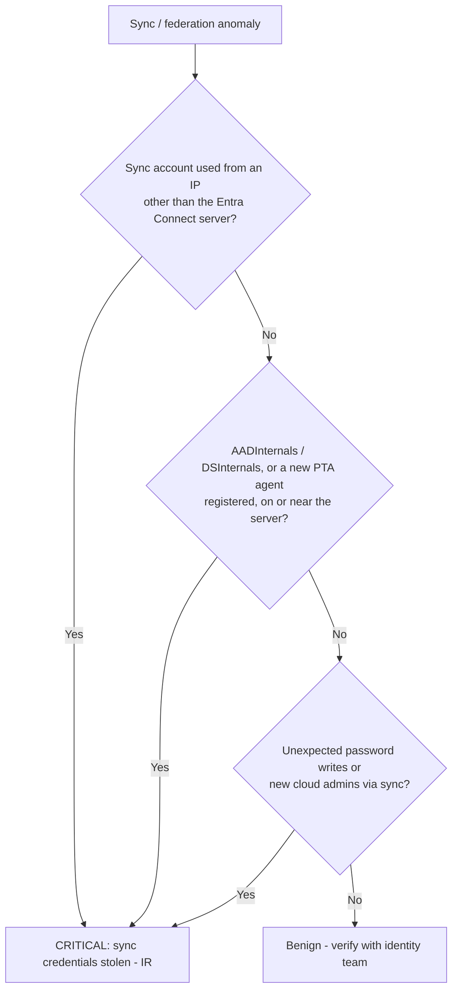

# Hybrid Identity Server Compromise (Entra Connect / AD FS)

> The Entra Connect (sync) server holds credentials that can **reset any synced password** and read password hashes. AD FS signs every federated token, and Pass-through Authentication agents see passwords in clear text. Compromising one of these bridges on-prem and cloud. **They are tier 0 and must be protected and monitored like domain controllers.**

## When this fires
- `entra_federation_settings_changed` / `entra-domain-federation-changed`: federation or domain authentication changed
- `entra-user-created-outside-sync`: cloud users created or modified by the sync account in unusual ways
- Hunt below: the directory-sync account signing in from anywhere other than the sync server

## Triage decision tree


## Investigation steps
1. Where does the directory-sync account sign in from?
   ```kql
   SigninLogs
   | union AADNonInteractiveUserSignInLogs
   | where TimeGenerated > ago(14d)
   | where UserPrincipalName startswith "Sync_" or UserPrincipalName startswith "ADToAADSyncServiceAccount"
   | summarize SignIns = count(), Apps = make_set(AppDisplayName, 10) by UserPrincipalName, IPAddress, ResultType
   ```
   Any IP other than the Entra Connect server's egress is a stolen-credential indicator.
2. Review what the sync identity changed in Entra: password resets, new users, role or group changes outside the normal sync pattern (AuditLogs, initiator = the sync account).
3. On the servers (EDR): `AADInternals` / `DSInternals` modules, access to the ADSync database (`mms_management_agent`), `Export-AADIntSyncCredentials`, AD FS DKM key reads, and new Pass-through Authentication agent registrations.
4. Check for new or changed federated domains ([federation tampering](federation-trust-tampering.md)).

## True vs false positive

| Points to attack | Points to benign |
|---|---|
| Sync account signs in from a VPS or a user workstation | Staging-mode server documented by the identity team |
| PowerShell loading AADInternals on the sync server | Entra Connect upgrade by the vendor-recommended process |
| Cloud-only admin created by the sync identity | Normal password-hash sync cycles every two minutes |

## Containment & response
- Isolate the compromised server. Reset the AD DS connector account and the Entra sync account (re-run the Entra Connect wizard to rotate credentials).
- AD FS: rotate token-signing and token-decrypting certificates (twice); consider moving to managed authentication.
- PTA: remove unknown agents. Revoke sessions for privileged cloud accounts, and review all role and credential changes.
- Treat these servers as tier 0: admin only from PAWs, no internet browsing, EDR in block mode, and alerting on all sign-ins of sync identities.

## Escalation criteria
Always escalate to IR and the identity owners.

## Evidence to collect
Sync account sign-ins, AuditLogs changes by sync identities, server EDR timeline, ADSync and AD FS logs, PTA agent list.
