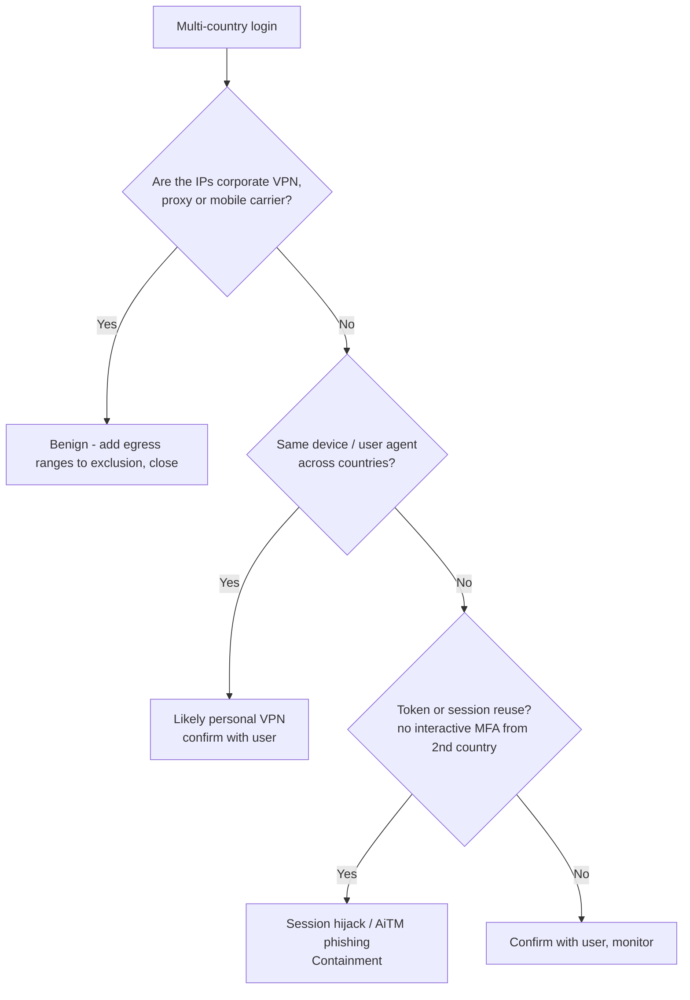

# Impossible Travel / Multi-Country Logins

> Successful logins for one account from several countries in a short window. Most are VPNs - the job is to find the one that isn't.

## When this fires
- `auth_login_multiple_countries` - successful logins from 3+ countries within 1h
- `entra_high_risk_signin` - Entra ID Protection flagged a successful sign-in as high risk

## Triage decision tree

## Investigation steps
1. List the countries, IPs, ASNs and user agents (`$countries` outcome).
2. Check whether the second location completed MFA or reused a session/refresh token - token reuse without MFA suggests **adversary-in-the-middle (AiTM) phishing** (Evilginx, Tycoon).
3. Search the user's mailbox for a recent phishing email leading to a fake login page.
4. Review activity from the suspicious location: mail access, file downloads, consent grants.

## Containment & response
- Revoke sessions and refresh tokens (password reset alone does **not** kill stolen session cookies).
- Reset password, review MFA methods and inbox rules.
- Block the attacker IP / ASN in Conditional Access; consider token protection and compliant-device requirements.

## Escalation criteria
Session reuse without MFA, mailbox/file access from the suspicious country, or privileged users → IR.

## Evidence to collect
Sign-in records (IPs, ASNs, UAs, session IDs), phishing email (if any), post-access activity.
