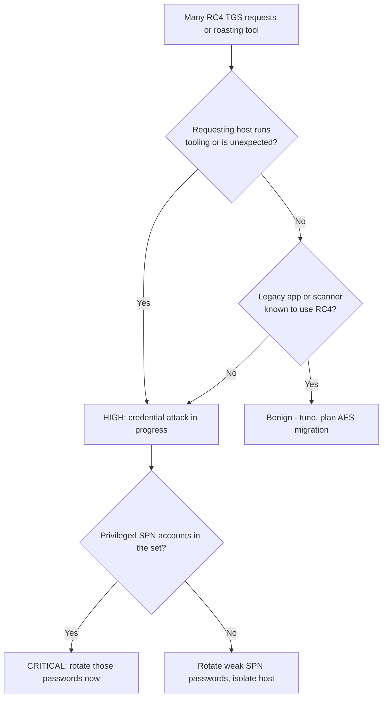

# Kerberoasting

> Any domain user can request service tickets for accounts with an SPN. Tickets encrypted with **RC4 (etype 0x17)** can be cracked offline, and service accounts often have old passwords and high privileges. The question is whether someone **requested many RC4 tickets they don't normally need**.

## When this fires
- `win_kerberoasting_tooling`: Rubeus, Invoke-Kerberoast, `setspn -Q` style enumeration or impacket `GetUserSPNs` patterns on an endpoint
- `kerberoasting-rc4-tgs`: one account requests RC4 service tickets (4769, `TicketEncryptionType` 0x17) for many distinct services

## Triage decision tree


## Investigation steps
1. List the services requested by the suspect account. `TicketEncryptionType` lives inside `EventData`:
   ```kql
   let acct = "<ACCOUNT>";
   SecurityEvent
   | where TimeGenerated > ago(1d) and EventID == 4769
   | extend Xml = parse_xml(EventData)
   | mv-apply D = Xml.EventData.Data on (
       summarize Etype = take_anyif(tostring(D["#text"]), tostring(D["@Name"]) == "TicketEncryptionType"),
                 Svc = take_anyif(tostring(D["#text"]), tostring(D["@Name"]) == "ServiceName"),
                 Client = take_anyif(tostring(D["#text"]), tostring(D["@Name"]) == "IpAddress"))
   | where TargetUserName has acct and Etype == "0x17"
   | summarize Services = dcount(Svc), ServiceList = make_set(Svc, 50) by TargetUserName, Client
   ```
2. Identify the client host behind `IpAddress` and pull its process tree around the time: PowerShell, `Rubeus.exe`, Python/impacket from a non-Windows host.
3. Rank the requested SPN accounts: privileged group membership, password age (`pwdLastSet`), and whether AES is enabled (`msDS-SupportedEncryptionTypes`).
4. SecOps pivot on the client:
   ```
   metadata.product_event_type = "4769" AND principal.ip = "<CLIENT_IP>"
   ```

## True vs false positive

| Points to attack | Points to benign |
|---|---|
| 10+ distinct SPNs in minutes from a workstation | One RC4 ticket for a legacy app's SPN, every day, same host |
| Roasting tool command line on the client | Vulnerability scanner with an approved service account |
| Requests for accounts in Domain Admins / SQL admins | Ticket requests from a DC or a known RADIUS / NAS |

## Containment & response
- Isolate the client host and disable the requesting account if it is not the legitimate user.
- **Reset the passwords of every roasted SPN account** (25+ characters, random), privileged ones first. Move to gMSA where possible.
- Disable RC4 for service accounts (AES only), and monitor for 4769 with 0x17 afterwards.
- Remove unnecessary SPNs and privileges from service accounts.

## Escalation criteria
Tooling confirmed, privileged SPNs roasted, or a privileged SPN account used afterwards from new hosts → IR.

## Evidence to collect
4769 events, client host EDR timeline, the list of SPN accounts with privilege level, and password reset records.
