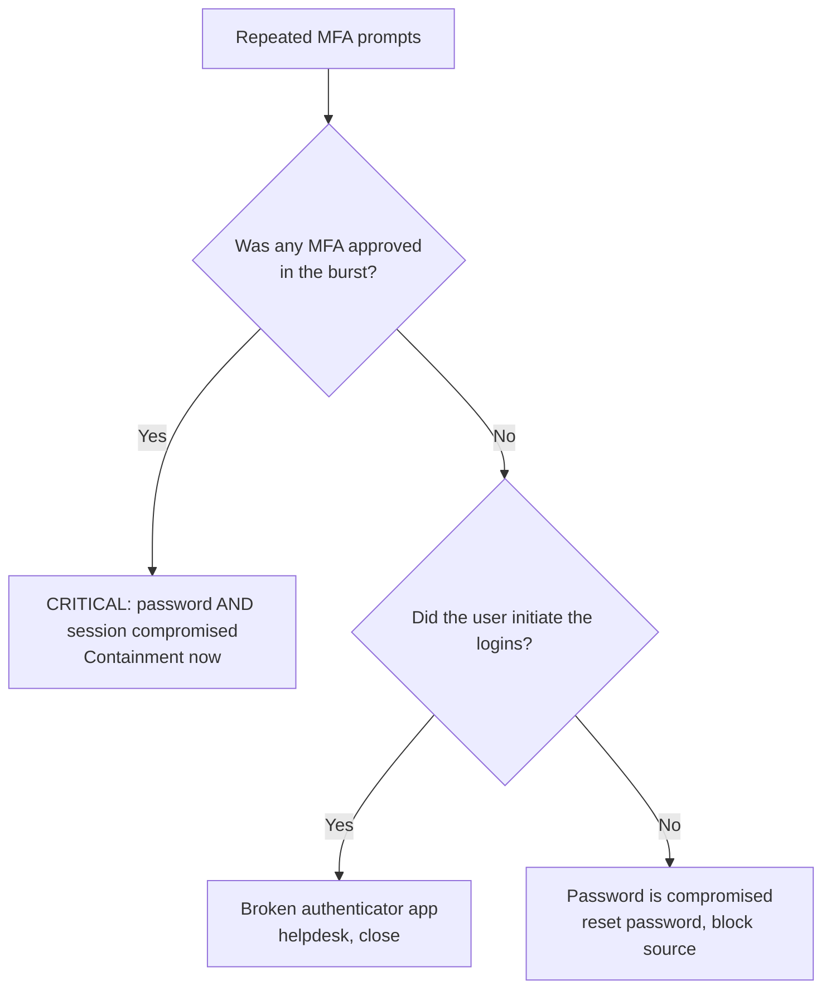

# MFA Fatigue / Push Bombing

> The attacker already has the password and spams MFA prompts until the user taps "Approve" (Uber 2022, Lapsus$).

## When this fires
- `entra_mfa_fatigue` - 5+ MFA denials/timeouts for one user in 15 min
- `entra_mfa_method_changed` shortly after - attacker registering their own authenticator

## Triage decision tree

## Investigation steps
1. Pull all sign-ins for the user in the last 24h: IPs, user agents, apps, results.
2. Identify the attacker source (IPs of the MFA-denied sign-ins) and check other users for the same IPs.
3. Check for a successful sign-in from that source, then MFA method registration, inbox rules, consent grants.
4. Ask the user (out-of-band): did they receive unexpected prompts / phone calls ("IT support" vishing)?

## Containment & response
- Reset the password (the attacker knows it) and revoke sessions.
- If any prompt was approved: remove newly registered MFA methods, review all activity post-approval (see [Brute force success](brute-force-success.md)).
- Enable **number matching** and **additional context** in Microsoft Authenticator; consider phishing-resistant MFA (FIDO2) for admins.

## Escalation criteria
Any approved prompt, privileged user, or the same source hitting multiple users → IR.

## Evidence to collect
Sign-in log extract, MFA result codes, attacker IPs/UAs, user statement.
