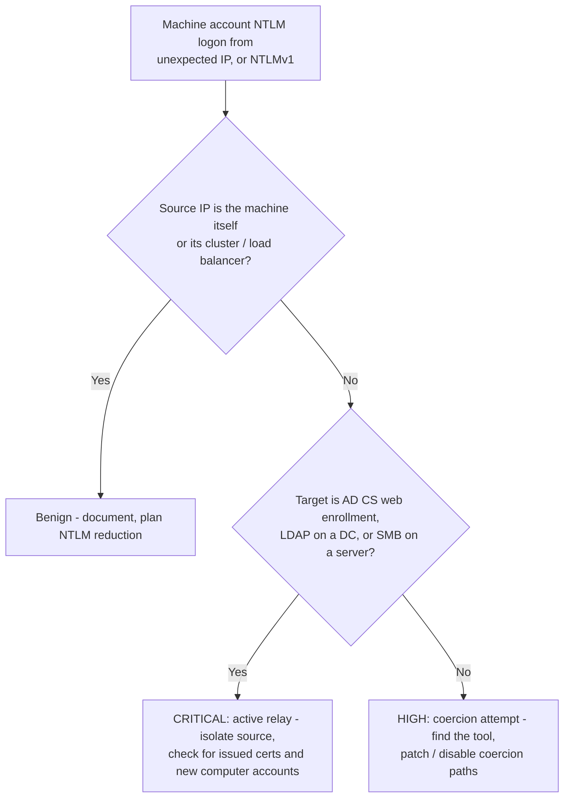

# NTLM Relay and Authentication Coercion

> The attacker forces a server, often a domain controller, to authenticate to them (PetitPotam, PrinterBug, DFSCoerce), then relays that NTLM authentication to AD CS, LDAP or SMB. The result can be a DC certificate, a new computer account with delegation rights, or admin on a server, **with no password needed**. The tell is a machine account authenticating from the wrong place.

## When this fires
- `win_ntlmv1_logon` / `ntlmv1-authentication`: NTLMv1 authentication (trivially crackable or relayable) on a DC or server
- Hunt below: a DC or server machine account (`NAME$`) logging on over NTLM from an IP that is not that machine

## Triage decision tree


## Investigation steps
1. Machine accounts authenticating over NTLM from someone else's IP:
   ```kql
   SecurityEvent
   | where TimeGenerated > ago(1d) and EventID == 4624 and LogonType == 3
   | where AuthenticationPackageName == "NTLM" and TargetUserName endswith "$"
   | summarize Logons = count(), Targets = make_set(Computer, 20), LmPackages = make_set(LmPackageName)
       by TargetUserName, IpAddress, WorkstationName
   | order by Logons desc
   ```
   Map each `IpAddress` to its hostname. `DC01$` authenticating from a workstation IP is a relay.
2. Find the coercion. On the DC, look for inbound RPC to EFSRPC / spooler / DFS named pipes from the attacker host (`\pipe\lsarpc`, `\pipe\efsrpc`, `\pipe\spoolss`, `\pipe\netdfs`) in EDR network events, and for tools such as `PetitPotam`, `Coercer`, `ntlmrelayx` and `Responder` on the source.
3. Check what the relay achieved: certificates issued to the DC machine account ([AD CS abuse](adcs-certificate-abuse.md)), new computer accounts (4741) with `msDS-AllowedToActOnBehalfOfOtherIdentity` set, and new local admins on target servers.
4. SecOps pivot:
   ```
   metadata.product_event_type = "4624" AND target.user.userid = /\$$/ AND extensions.auth.auth_details = "NTLM"
   ```

## True vs false positive

| Points to attack | Points to benign |
|---|---|
| `DC01$` NTLM logon originating from a user workstation | Cluster or NAS presenting a machine account from its own VIP |
| Responder / ntlmrelayx found on the source host | Legacy app still using NTLMv1 (needs a fix, but not an attack) |
| New computer account created right after | Vulnerability scanner with documented coercion checks |

## Containment & response
- Isolate the relay host; revoke any certificates issued during the window, and delete rogue computer accounts.
- Remove the relay targets: **SMB signing** required everywhere, **LDAP signing and channel binding** on DCs, **EPA / HTTPS** on AD CS web enrollment (or disable it).
- Remove the coercion paths: disable the Print Spooler on DCs, apply the EFSRPC mitigations, and filter RPC where possible.
- Disable NTLMv1 (LmCompatibilityLevel 5), set `ms-DS-MachineAccountQuota` to 0, and audit NTLM usage on the way to restricting it.

## Escalation criteria
Any relayed DC machine account, or a certificate / delegation change produced by the relay → IR (tier-0 incident).

## Evidence to collect
4624 / 4741 / 4887 events, relay host EDR timeline and tools, network flows from the relay host to the targets.
