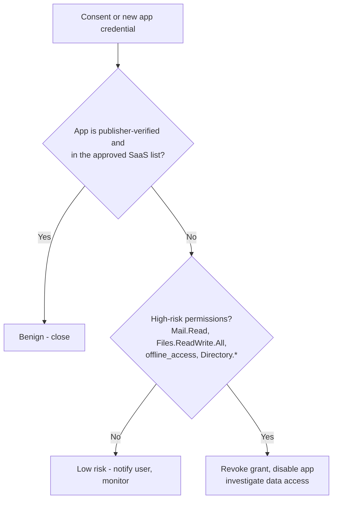

# Illicit OAuth Consent / App Credential Backdoor

> A malicious app gets persistent API access to mail/files via user consent, or an attacker adds a secret to an existing app registration. Neither is fixed by a password reset.

## When this fires
- `entra_app_consent_granted` - a user/admin consented to an application
- `entra_sp_credentials_added` - new secret/certificate on a service principal
- `entra-risky-oauth-consent` (Sentinel): A user or admin consented to an application that requested mailbox, file or directory-wide permissions
- `oauth-app-mass-access` (Sentinel): A single OAuth application (by application id) accesses data on behalf of 10+ different users within an hour

## Triage decision tree

## Investigation steps
1. Identify the app (App ID, publisher, reply URLs, creation date). Recently created multi-tenant apps with generic names ("Office Update", "PDF Viewer") are red flags.
2. List the permissions granted and whether consent was user or admin.
3. For new credentials: who added it, and has the service principal signed in from new IPs since?
4. Check the app's sign-in and Graph activity logs for mailbox/file access.

## True vs false positive

| Points to attack | Points to benign |
|---|---|
| App requests Mail.Read / Files.ReadWrite.All / offline_access, unverified publisher | Verified publisher app used across the industry |
| Consent right after a phishing email with a consent link | IT-approved app in the admin consent workflow |
| App starts mass mailbox or file access | Low-scope app (User.Read) for SSO only |

## Containment & response
- Revoke the OAuth grant and disable the service principal.
- Remove attacker-added secrets/certificates; rotate legitimate ones.
- Restrict user consent to verified publishers / low-risk permissions (tenant setting).

## Escalation criteria
High-privilege permissions granted, app accessed data, or a credential was added to a privileged first-party app → IR.

## Evidence to collect
App registration details, consent audit record, permission list, Graph activity of the app.
