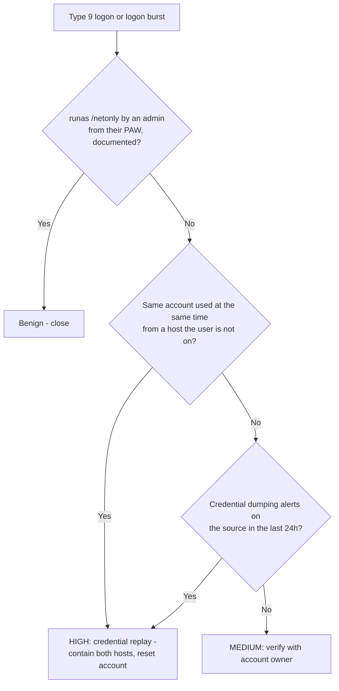

# Pass-the-Hash / Pass-the-Ticket

> With a stolen NTLM hash or Kerberos ticket, the attacker authenticates as the victim without knowing the password. That is why credential dumping on one host leads to admin on fifty. The fingerprints are a **"NewCredentials" logon (type 9)** on the attacker's host and **network logons that don't match where the user actually is**.

## When this fires
- `win_new_credentials_logon`: 4624 LogonType 9 with LogonProcess `seclogo`. This is what `sekurlsa::pth` and `runas /netonly` produce.
- `win_lateral_network_logon_burst` / `lateral-movement-network-logon-burst`: one account with network logons to many hosts

## Triage decision tree


## Investigation steps
1. Type 9 logons (the attacker's own host):
   ```kql
   SecurityEvent
   | where TimeGenerated > ago(2d) and EventID == 4624 and LogonType == 9
   | project TimeGenerated, Computer, SubjectUserName, TargetUserName, TargetOutboundUserName = tostring(column_ifexists("TargetOutboundUserName", "")),
       LogonProcessName, AuthenticationPackageName, ProcessName
   ```
   `seclogo` + `Negotiate` from an unusual process (not `runas.exe`) indicates pass-the-hash tooling.
2. Where did the replayed credential go? Network logons for the impersonated account, grouped by source:
   ```kql
   let acct = "<ACCOUNT>";
   SecurityEvent
   | where TimeGenerated > ago(2d) and EventID == 4624 and LogonType == 3 and TargetUserName =~ acct
   | summarize Hosts = make_set(Computer, 50), Count = count() by IpAddress, AuthenticationPackageName, LogonProcessName
   ```
   NTLM network logons by an account that normally uses Kerberos, or Kerberos logons from a host where the user has no interactive session, are the signal.
3. Pass-the-ticket: 4769 service tickets for the account from an IP where no 4768 TGT was issued to it, and ticket lifetimes or encryption types that don't match domain policy.
4. Go back to the source of the credential: which host had the account's session cached? Check LSASS access there ([credential dumping](../endpoint/credential-dumping.md)).

## True vs false positive

| Points to attack | Points to benign |
|---|---|
| Type 9 logon spawned by an unknown binary or PowerShell | `runas /netonly` by a named admin, documented |
| Domain Admin network logons from a help-desk workstation | Admin working from their PAW / jump host |
| NTLM where Kerberos is expected, at odd hours | Legacy app that only does NTLM, stable for months |

## Containment & response
- Isolate the source host; reset the replayed account. For tickets, purge them (`klist purge`) and, for privileged accounts, reset twice.
- If a tier-0 account was replayed, assume domain compromise and scope accordingly.
- Reduce the attack surface: Protected Users group for admins, Credential Guard, LAPS for local admin, deny network logon for local accounts, and tiered admin so DA credentials never touch workstations.

## Escalation criteria
Any replay of a privileged credential, or replay across more than one host → IR.

## Evidence to collect
4624 (types 3, 9, 10), 4768/4769 for the account, source host EDR timeline, list of hosts touched.
