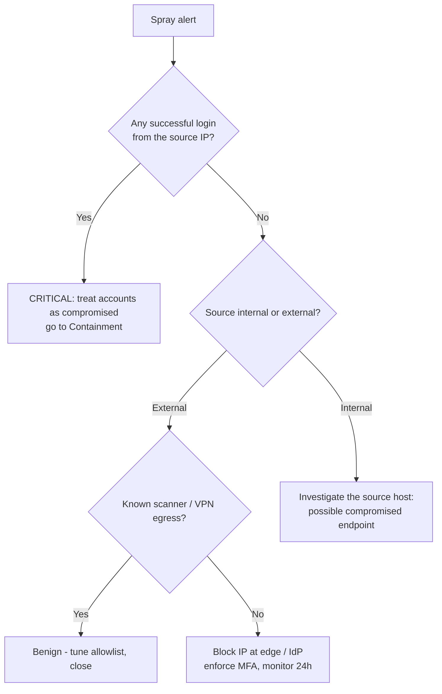

# Password Spray

> One source tries a few common passwords against many accounts to stay under lockout thresholds. The question that matters: **did any account succeed?**

## When this fires
- `auth_password_spray_single_source` - one IP failing against 15+ accounts in 30 min
- `auth_spray_then_success` - same, followed by a **successful** login (treat as CRITICAL)
- `win_account_lockout_burst` - 5+ AD lockouts in 15 min
- `entra-password-spray` (Sentinel): One IP address fails Entra ID sign-in against 15 or more different accounts inside 30 minutes, using invalid-password error codes
- `entra-spray-followed-by-success` (Sentinel): An IP that failed against 10+ accounts then produces a hit within the next hour: a successful sign-in, or a correct password that was only stopped by password expiry, MFA or Conditional Access
- `entra-smart-lockout-burst` (Sentinel): Entra smart lockout (50053) fired for 5+ different accounts within 30 minutes

## Triage decision tree


## Investigation steps
1. **Did anything succeed?** Search successful logins from the source in the window ±2h:
   ```
   metadata.event_type = "USER_LOGIN"
   security_result.action = "ALLOW"
   principal.ip = "<SOURCE_IP>"
   ```
2. **What was targeted?** List failed accounts - are they privileged, service, or disabled/ex-employee accounts?
   ```
   metadata.event_type = "USER_LOGIN" and security_result.action = "BLOCK" and principal.ip = "<SOURCE_IP>"
   ```
3. **Where did it come from?** Enrich the IP (geo, ASN, hosting provider, threat intel, Tor exit). Cloud/VPS ASN = likely malicious.
4. **Which protocol?** Legacy auth (IMAP/POP/SMTP basic auth, NTLM) bypasses MFA - check `extensions.auth.mechanism` / client app.
5. **Internal source?** Pivot to the host: running processes, logged-on user, recent EDR alerts (`principal.ip` → `principal.hostname`).

## True vs false positive
| Likely true positive | Likely false positive |
|---|---|
| Hosting/VPS ASN, Tor, foreign geo | Corporate NAT / VPN egress |
| Alphabetical or HR-list-like usernames | Single app with expired service creds |
| Non-existent usernames in the list | Vulnerability scanner IP |
| Legacy auth protocols | Change of SSO configuration |

## Containment & response
- **Any success:** reset password, revoke sessions/refresh tokens, review MFA methods registered in the last 24h, check mailbox rules → [Brute force that succeeded](brute-force-success.md).
- Block the source IP at the IdP (Entra named locations / Okta network zones) and perimeter.
- Disable legacy authentication if it was used.

## Escalation criteria
Escalate to Tier-2 / IR if: any login succeeded · a privileged account was targeted successfully · source is internal · spray continues after blocking (rotating IPs).

## Evidence to collect
Source IPs + enrichment, list of targeted accounts, successful accounts, protocols used, timeline.
