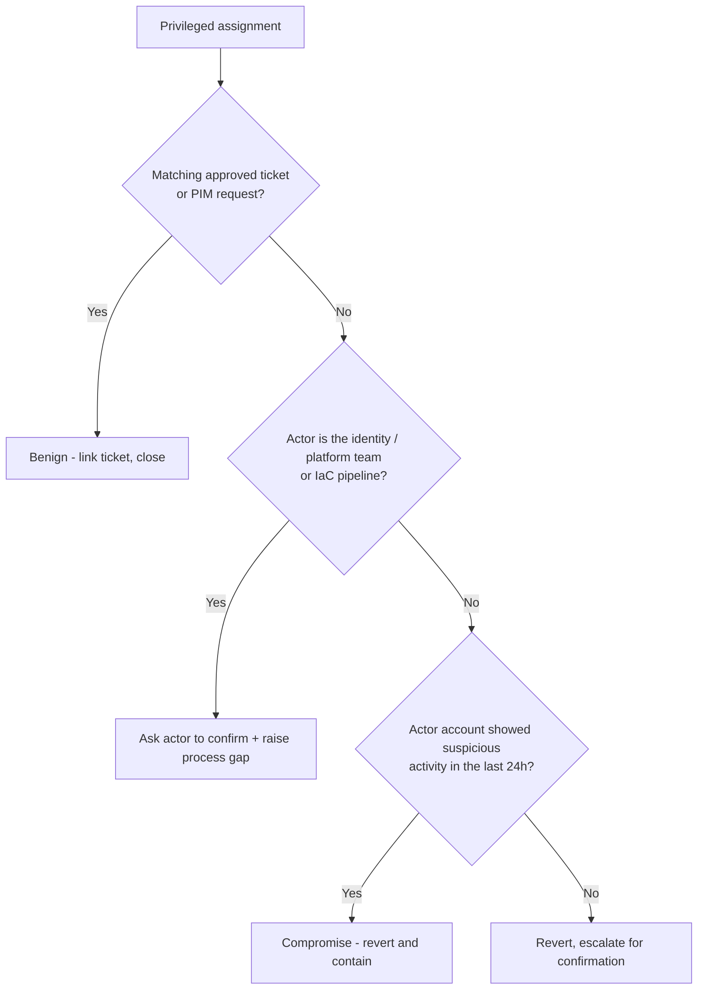

# Privileged Role or Group Assignment

> Someone gained admin rights - Domain Admins, Global Administrator, Owner, AdministratorAccess. Every one of these must map to an approved change.

## When this fires
Any rule in `related_rules` - AD privileged groups, Entra directory roles, Azure RBAC, AWS IAM policies, GCP IAM.
- `entra-global-admin-assigned` (Sentinel): A user or service principal was added to a high-privilege directory role such as Global Administrator or Privileged Role Administrator
- `privileged-group-member-added` (Sentinel): Someone was added to Domain Admins, Enterprise Admins, Administrators or another highly privileged group (events 4728, 4732, 4756)
- `new-account-added-to-privileged-group` (Sentinel): An account is created (4720) and added to Domain Admins / Administrators / another privileged group within an hour
- `azure-role-assignment-created` (Sentinel): A new Azure RBAC role assignment

## Triage decision tree


## Investigation steps
1. **Who** granted it (actor), **to whom** (target), **what** role, **where** (scope: domain, tenant, subscription, account, org).
2. Search the change ticket / PIM approval system.
3. Review the actor's recent sign-ins and alerts - a compromised admin granting rights to a second attacker-controlled account is a common persistence pattern.
4. Review the target's activity after the grant:
   ```
   principal.user.userid = "<TARGET_USER>"
   ```

## True vs false positive

| Points to attack | Points to benign |
|---|---|
| Permanent assignment outside PIM, or to a new account | PIM-eligible assignment with approval |
| Assigned by an admin whose own session is risky | Access review or onboarding ticket matches the change |
| Account added to Domain Admins and removed hours later | Break-glass test documented in advance |

## Containment & response
- Remove the assignment if unapproved (keep evidence first).
- Reset credentials of both actor and target if compromise is suspected; revoke sessions.
- Hunt for other assignments by the same actor in the last 30 days.

## Escalation criteria
No approval found, actor shows suspicious activity, or the role is tenant/domain-wide (Global Admin, Domain Admins, Owner at root/management group, Organization Admin) → IR.

## Evidence to collect
Audit log entries, ticket references, actor/target activity timeline.
