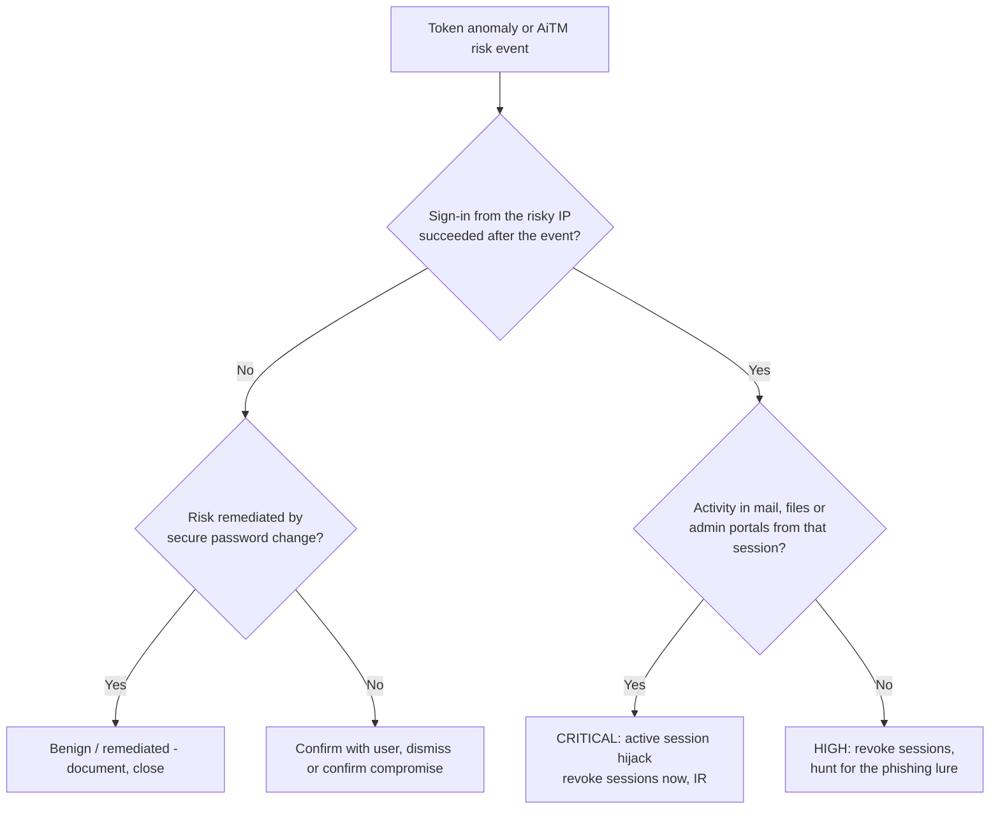

# Token Theft / Session Replay

> The attacker is not guessing passwords. They stole a session cookie or refresh token (AiTM phishing kit, infostealer, malicious extension) and replay it, so **MFA has already been satisfied**. Resetting the password alone does not evict them.

## When this fires
- `entra_token_theft_risk_detection` / `entra-token-theft-risk-detections`: ID Protection raised `anomalousToken`, `tokenIssuerAnomaly`, `attackerinTheMiddle` or a related token detection
- `entra_high_risk_signin` / `entra-high-risk-user`: the user or sign-in reached high risk

## Triage decision tree


## Investigation steps
1. List the risk events and the IPs, ASNs and user agents behind them.
   ```kql
   let upn = "<USER_UPN>";
   AADUserRiskEvents
   | where TimeGenerated > ago(7d) and UserPrincipalName =~ upn
   | project TimeGenerated, RiskEventType, RiskLevel, RiskState, DetectionTimingType, IpAddress, Location, CorrelationId
   ```
2. Compare the risky IP against the user's normal sign-in footprint. A token replayed from new infrastructure usually shows a **different ASN and user agent within the same session window**.
   ```kql
   let upn = "<USER_UPN>";
   union SigninLogs, AADNonInteractiveUserSignInLogs
   | where TimeGenerated > ago(7d) and UserPrincipalName =~ upn and ResultType == "0"
   | summarize SignIns = count(), Apps = make_set(AppDisplayName, 20), UserAgents = make_set(UserAgent, 10),
       First = min(TimeGenerated), Last = max(TimeGenerated) by IPAddress, AutonomousSystemNumber
   | order by First asc
   ```
   SecOps UDM search:
   ```
   metadata.event_type = "USER_LOGIN" AND target.user.email_addresses = "<USER_UPN>" AND security_result.action = "ALLOW"
   ```
3. Find the lure. Look for a phishing email or URL click in the hour before the first risky sign-in (`EmailEvents`, `UrlClickEvents`). For an infostealer, check the user's devices for recent EDR alerts.
4. Work out what the session did: mailbox access (`MailItemsAccessed`), new inbox rules, file downloads, MFA method registration, consent grants.

## True vs false positive

| Points to compromise | Points to benign |
|---|---|
| New ASN (hosting/VPS) with a success minutes after a phishing click | Corporate VPN or mobile carrier the user normally uses |
| `attackerinTheMiddle` detection | Risk dismissed after a verified user travel / device change |
| Inbox rule or MFA method added from the risky session | No activity beyond the sign-in itself |

## Containment & response
- **Revoke all refresh tokens and sessions** (Entra: *Revoke sessions*; `Revoke-MgUserSignInSession`). This is the step that actually evicts the attacker.
- Reset the password and review MFA methods. Remove any the user did not register.
- Remove inbox rules, forwarding, OAuth grants and devices created during the attacker window.
- Block the attacker IPs and lure domains; purge the phishing email tenant-wide.
- Harden: phishing-resistant MFA (FIDO2/passkeys) for admins, compliant-device Conditional Access, Token Protection where supported, and Continuous Access Evaluation.

## Escalation criteria
Any confirmed replay with post-authentication activity, a privileged user, or several users hit by the same lure → IR.

## Evidence to collect
Risk events with CorrelationIds, sign-in logs (interactive and non-interactive) for the window, the phishing email and URL, mailbox audit records, and a list of the changes the attacker made.
