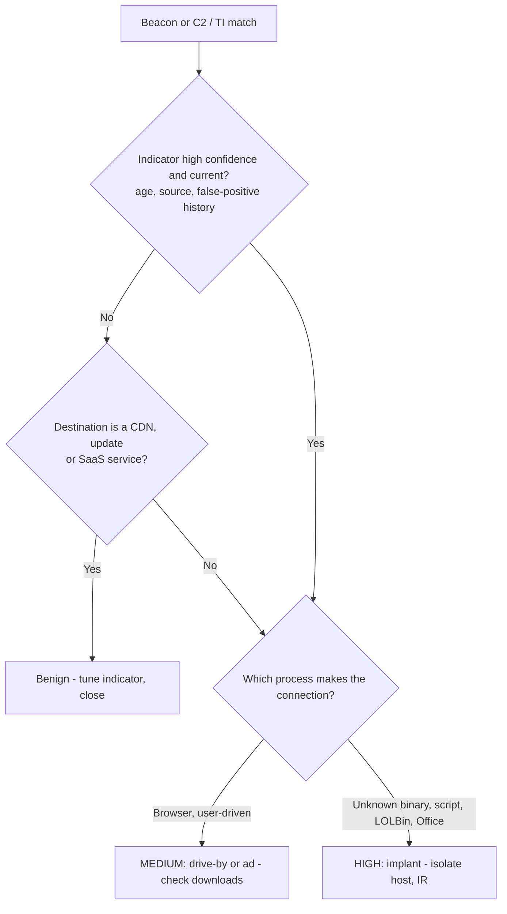

# C2 Beaconing / Threat-Intel Match

> Implants check in with their command-and-control server on a schedule, often with jitter. Regular, small, outbound connections to a rare destination, or any hit on a high-confidence C2 indicator, mean **a host may already be under remote control**. A blocked connection is still evidence of an infection.

## When this fires
- `beaconing-regular-intervals`: low variance (jitter) in connection intervals from one host to one destination over hours
- `fgt_botnet_c2_detected`, `umb_c2_or_malware_blocked`: firewall or DNS security product flagged botnet / C2 / malware destinations
- `ti-ip-match-firewall`, `ti-domain-match-dns`: traffic matches a threat-intelligence indicator
- `umb_newly_seen_domains_burst` / `newly-observed-domain`: a host contacts many newly registered or first-seen domains

## Triage decision tree


## Investigation steps
1. Confirm the periodicity and volume to the destination:
   ```kql
   let dest = "<DEST_IP>";
   DeviceNetworkEvents
   | where TimeGenerated > ago(1d) and RemoteIP == dest
   | sort by DeviceName asc, TimeGenerated asc
   | extend Delta = datetime_diff("second", TimeGenerated, prev(TimeGenerated)), Same = DeviceName == prev(DeviceName)
   | where Same
   | summarize Connections = count(), AvgInterval = avg(Delta), StdDev = stdev(Delta),
       Processes = make_set(InitiatingProcessFileName, 10) by DeviceName, RemoteUrl, RemotePort
   | extend Jitter = round(StdDev / AvgInterval, 2)
   ```
   A jitter below about 0.2, with hundreds of connections, means the traffic is machine-driven.
2. Identify the process and its lineage: the parent, the binary's signer and prevalence, and when it first appeared on disk.
3. Check the indicator itself: TI source, confidence, first and last seen, and whether the IP is a shared host (CDN, cloud) where many unrelated sites live.
4. Look for other hosts talking to the same destination, or using the same JA3 / JA4 or user agent.
5. SecOps pivot:
   ```
   target.ip = "<DEST_IP>" OR network.dns.questions.name = "<DOMAIN>"
   ```

## True vs false positive

| Points to C2 | Points to benign |
|---|---|
| `rundll32` / unsigned exe beaconing every 60 s ± 10 % | Windows Update, AV or telemetry agents (signed, high prevalence) |
| Newly registered domain, rare across the fleet | Indicator is a CDN IP shared with legitimate sites |
| Multiple hosts start beaconing after the same phish | Monitoring heartbeat to a known SaaS |

## Containment & response
- Isolate the host and block the destination (IP, domain, SNI) at the firewall, proxy and DNS layers.
- Collect memory and the implant binary before reimaging, for IOC extraction.
- Hunt fleet-wide for the destination, hash, named pipes and persistence of the implant.
- Feed confirmed IOCs back into TI with context. Expire stale indicators to keep false positives down.

## Escalation criteria
Any confirmed implant, multiple beaconing hosts, or C2 from a server → IR.

## Evidence to collect
Connection timeline, process tree and binary, memory image, DNS and proxy records, and indicator provenance.
