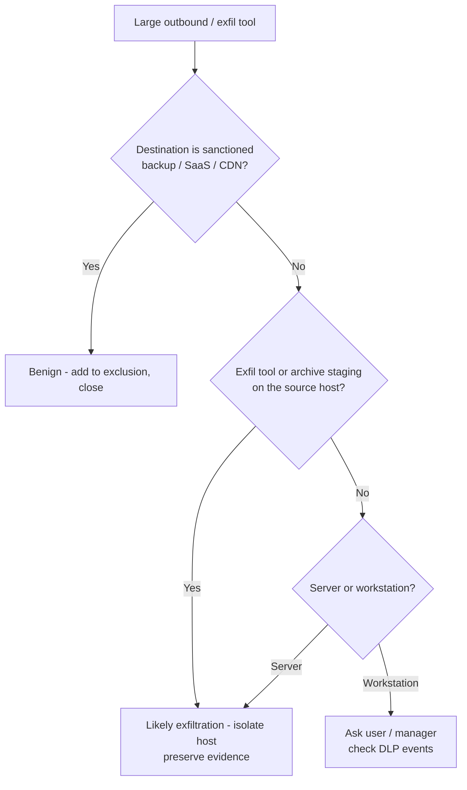

# Large Outbound Transfer / Exfiltration Tools

> Double-extortion ransomware steals data first. Rclone, MEGA and password-protected archives are the usual tools.

## Triage decision tree

## Investigation steps
1. Destination IP/domain, ASN, and service (MEGA, Dropbox, attacker VPS).
2. Process responsible for the traffic (EDR network events on the host).
3. Staging: archives created before the transfer (`7z a -p`, `rar a -hp`), mapped shares accessed.
4. Which data? File paths in archive commands / rclone config, DLP incidents for the same user.

## Containment & response
- Block the destination; isolate the host if exfil is ongoing.
- Disable the account used; revoke cloud storage tokens found in rclone config.
- Treat as precursor to ransomware - run the ransomware playbook checks fleet-wide.

## Escalation criteria
Confirmed exfiltration of business data → IR + legal/privacy.

## Evidence to collect
Flow/proxy logs with byte counts, tool command lines and config, archive names, data inventory.
