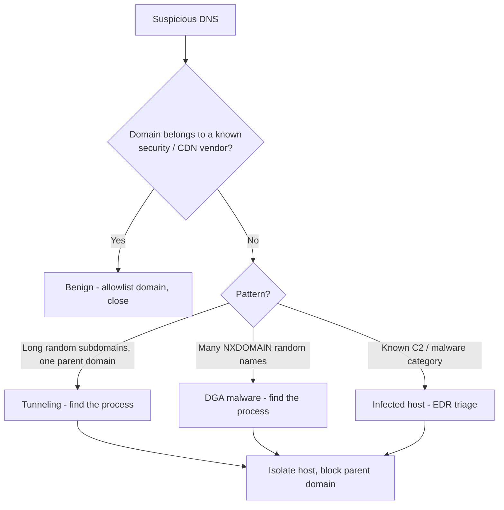

# DNS Tunneling, DGA and C2 Domains

> DNS is allowed everywhere, so malware uses it to find C2 (DGA) and even to carry data (tunneling).

## Triage decision tree

## Investigation steps
1. Group the queries by parent (registered) domain - tunneling uses one parent with thousands of unique subdomains.
2. Registration age and reputation of the parent domain (WHOIS, passive DNS).
3. Map the source IP to a hostname and find the process making the queries (EDR DNS telemetry / Sysmon EID 22).
4. Volume: bytes encoded in labels × query count ≈ data exfiltrated.

## Containment & response
- Block the parent domain at DNS security (Umbrella) and firewall.
- Isolate the host; triage the process with EDR.
- Force all DNS through corporate resolvers; block outbound 53/853 and known DoH endpoints elsewhere.

## Escalation criteria
Tunneling confirmed (possible exfiltration) or C2 from a server → IR.

## Evidence to collect
Query samples, parent domain intel, source host/process, estimated data volume.
