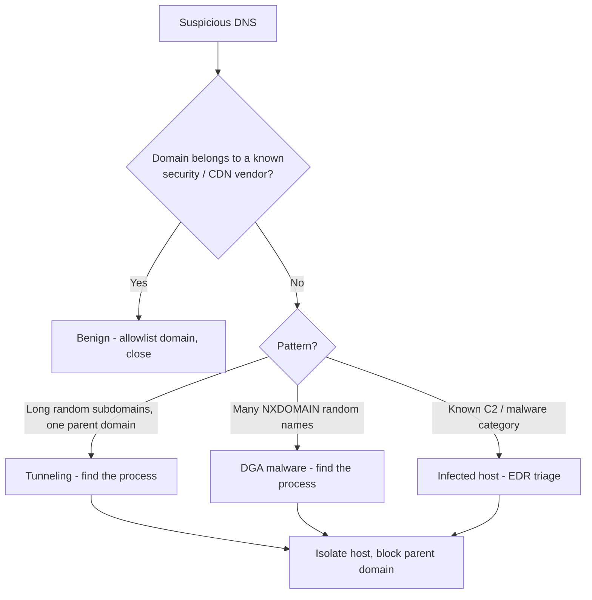

# DNS Tunneling, DGA and C2 Domains

> DNS is allowed everywhere, so malware uses it to find C2 (DGA) and even to carry data (tunneling).

## When this fires
- `net_dns_tunneling_long_subdomain` (SecOps): 50+ DNS queries with a 40+ character label from one host within 15 minutes - DNS tunneling (iodine, dnscat2, Cobalt Strike DNS beacons)
- `net_dns_nxdomain_burst_dga` (SecOps): 100+ distinct non-existent domains (NXDOMAIN) queried by one host within 15 minutes - domain generation algorithm (DGA) malware
- `net_dns_to_external_resolver` (SecOps): Internal host sends 20+ DNS queries per hour directly to an external resolver, bypassing corporate DNS and its security filtering
- `umb_c2_or_malware_blocked` (SecOps): Umbrella blocked DNS requests to malware or command-and-control / botnet domains for an internal identity
- `umb_newly_seen_domains_burst` (SecOps): 20+ requests to Newly Seen Domains from one host within 30 minutes - fresh attacker infrastructure, DGAs and phishing kits
- `fgt_botnet_c2_detected` (SecOps): FortiGate detected botnet / C2 communication from an internal host
- `dns-tunneling-long-labels` (Sentinel): A client resolves 50+ names with a 40+ character label within 15 minutes
- `dns-nxdomain-dga` (Sentinel): One client gets NXDOMAIN for 100+ distinct names within an hour (ASIM DNS)
- `dns-high-query-volume` (Sentinel): One client sends 10,000+ DNS queries in an hour (ASIM DNS)
- `ti-domain-match-dns` (Sentinel): Any ASIM-normalized DNS query (Windows DNS, Infoblox, Umbrella, Zscaler, Defender...) for a domain present in active threat intelligence

## Triage decision tree

## Investigation steps
1. Group the queries by parent (registered) domain - tunneling uses one parent with thousands of unique subdomains.
2. Registration age and reputation of the parent domain (WHOIS, passive DNS).
3. Map the source IP to a hostname and find the process making the queries (EDR DNS telemetry / Sysmon EID 22).
4. Volume: bytes encoded in labels × query count ≈ data exfiltrated.

## True vs false positive

| Points to attack | Points to benign |
|---|---|
| Long, high-entropy subdomains to one parent domain at high rates | Security or CDN products using encoded DNS lookups (e.g. AV reputation) |
| Bursts of NXDOMAIN for random-looking domains | Misconfigured search suffix generating NXDOMAINs |
| Host bypasses internal resolvers to talk to external DNS | Approved DoH / DoT resolver configured by IT |

## Containment & response
- Block the parent domain at DNS security (Umbrella) and firewall.
- Isolate the host; triage the process with EDR.
- Force all DNS through corporate resolvers; block outbound 53/853 and known DoH endpoints elsewhere.

## Escalation criteria
Tunneling confirmed (possible exfiltration) or C2 from a server → IR.

## Evidence to collect
Query samples, parent domain intel, source host/process, estimated data volume.
