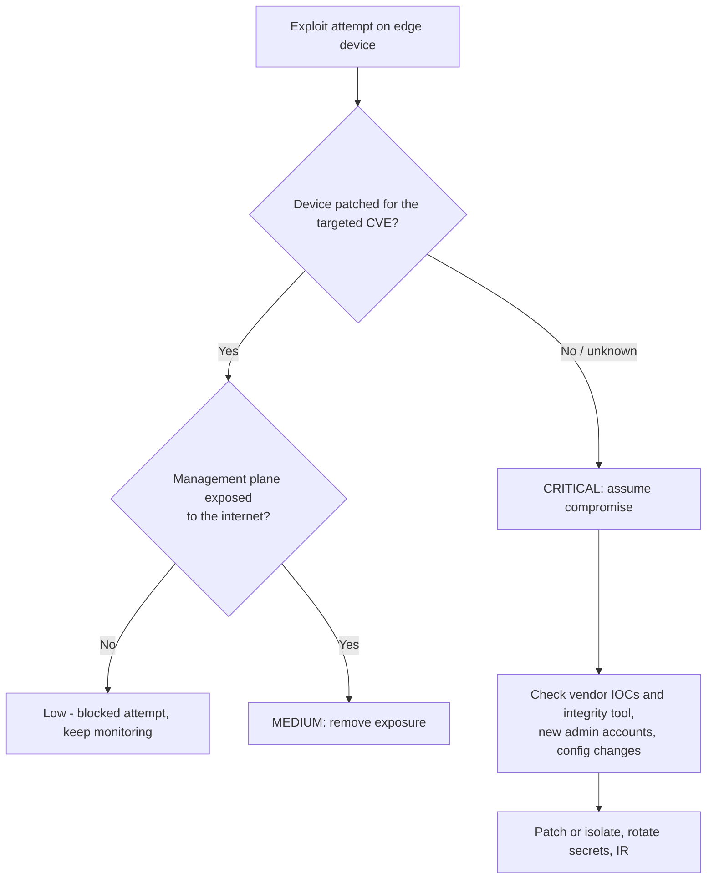

# Edge Device Exploitation (VPN, Firewall, Load Balancer)

> Firewalls, SSL-VPNs, load balancers and file-transfer appliances are among the most exploited assets, and **they run no EDR**. Attackers use pre-auth vulnerabilities to plant implants that survive upgrades. Treat exploit attempts against an *unpatched* device as a possible breach.

## When this fires
- `fgt_sslvpn_exploit_attempt` / `web-exploit-patterns-in-url`: IPS or WAF signatures for known SSL-VPN / management-plane exploits, path traversal or overflow patterns against the appliance
- `f5_bigip_management_exploit`: requests to BIG-IP management paths (iControl REST, TMUI) from untrusted sources
- `fgt_admin_login_from_internet` / `exposed-admin-services-inbound`: an admin interface reachable or logged into from the internet
- `fgt_ips_critical_attack`: a critical IPS signature targeting the device itself

## Triage decision tree


## Investigation steps
1. Find exploit traffic and any follow-on success against the appliance:
   ```kql
   let applianceIP = "<APPLIANCE_PUBLIC_IP>";
   CommonSecurityLog
   | where TimeGenerated > ago(7d) and DestinationIP == applianceIP
   | where DeviceAction !in ("deny", "drop", "block") or LogSeverity in ("8", "9", "10", "High", "Very-High")
   | summarize Hits = count(), Signatures = make_set(Activity, 20), URLs = make_set(RequestURL, 20) by SourceIP, DeviceAction
   | order by Hits desc
   ```
2. Map the device version against the vendor PSIRT and the CISA KEV catalog. An unpatched KEV-listed vulnerability means you should assume compromise.
3. On the device: new local admin accounts, config changes (`fgt_config_change`, `asa_config_change`), unexpected files or symlinks, and outbound connections **from** the appliance's own IP to the internet.
4. Run the vendor's integrity or IOC tooling (for example the Fortinet, Cisco or F5 published IOC checks) and compare the config to a known-good backup.
5. Check credentials the device holds (LDAP bind account, RADIUS secret, VPN users) for use elsewhere.

## True vs false positive

| Points to compromise | Points to benign |
|---|---|
| Exploit hits on a version listed as vulnerable, then a new admin account | Scanner traffic blocked by a patched device |
| Appliance initiates outbound connections to unknown IPs | Vendor cloud management connection (documented) |
| Config changed with no matching admin login | Change by the network team with a ticket |

## Containment & response
- Patch immediately, or take the vulnerable service offline (disable the SSL-VPN web portal or management interface on WAN).
- If compromise is suspected: follow the vendor's guidance. That often means a **factory reset and rebuild**, because implants can survive upgrades.
- Rotate every credential and secret configured on the device (LDAP / RADIUS, certificates, VPN pre-shared keys, local users).
- Never expose management interfaces to the internet; restrict them to an admin network.

## Escalation criteria
Exploit attempts against an unpatched or unknown-version device, or any sign of post-exploitation → IR immediately.

## Evidence to collect
IPS / WAF logs, device version and config diff, vendor integrity-check output, the appliance's outbound traffic, and admin login history.
