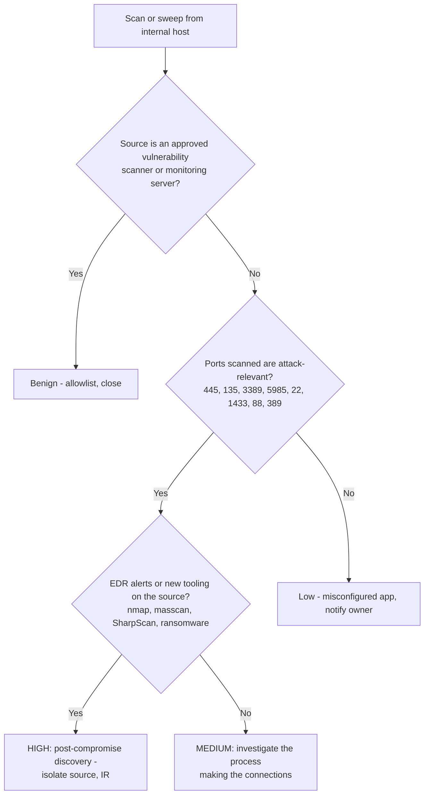

# Internal Port Scan / Host Sweep

> A host touching many ports on one target (vertical scan) or one port across many hosts (horizontal sweep) is **discovery from inside the network**, unless it is your scanner. The question is whether the source is an approved scanner, a misbehaving application, or a compromised host.

## When this fires
- `net_port_scan_vertical` / `port-scan-vertical`: one source to many destination ports on one host
- `net_host_sweep_horizontal` / `host-sweep-horizontal`: one source to many hosts on the same port (445, 3389, 22, 5985)
- `net_denied_spike_single_source`: a spike in firewall denies from one internal source

## Triage decision tree


## Investigation steps
1. Shape of the scan:
   ```kql
   let src = "<SOURCE_IP>";
   CommonSecurityLog
   | where TimeGenerated > ago(1d) and SourceIP == src
   | summarize Targets = dcount(DestinationIP), Ports = dcount(DestinationPort), TopPorts = make_set(DestinationPort, 30),
       Denied = countif(DeviceAction in ("deny", "drop", "block")) by bin(TimeGenerated, 15m)
   | order by TimeGenerated asc
   ```
2. Which process makes the connections? On the source host:
   ```kql
   let host = "<DEVICE_NAME>";
   DeviceNetworkEvents
   | where TimeGenerated > ago(1d) and DeviceName startswith host
   | summarize Remotes = dcount(RemoteIP), Ports = make_set(RemotePort, 30) by InitiatingProcessFileName, InitiatingProcessCommandLine, InitiatingProcessAccountName
   | order by Remotes desc
   ```
3. A sweep on 445 followed by SMB writes or service creation on targets means lateral movement or ransomware propagation is under way ([lateral movement](../endpoint/lateral-movement-remote-exec.md)).
4. SecOps pivot:
   ```
   principal.ip = "<SOURCE_IP>" AND metadata.event_type = "NETWORK_CONNECTION"
   ```

## True vs false positive

| Points to attack | Points to benign |
|---|---|
| Workstation sweeping 445 / 3389 across subnets | Qualys / Tenable / Rapid7 scanner on schedule |
| Unknown binary or PowerShell initiating the connections | Printer-discovery or backup agent |
| Preceded by an alert on the same host | Network monitoring (SNMP, ICMP) from the NMS |

## Containment & response
- Isolate the source if the process is unknown or malicious; collect the binary.
- Block workstation-to-workstation SMB / RDP / WinRM with host firewalls (also limits ransomware spread).
- Keep an inventory of scanner IPs and allowlist them explicitly, so real scans stand out.

## Escalation criteria
Scanning by malware or attacker tooling, or followed by authentication or execution on targets → IR.

## Evidence to collect
Flow and firewall logs, process-to-connection mapping on the source, and the list of targets that answered.
