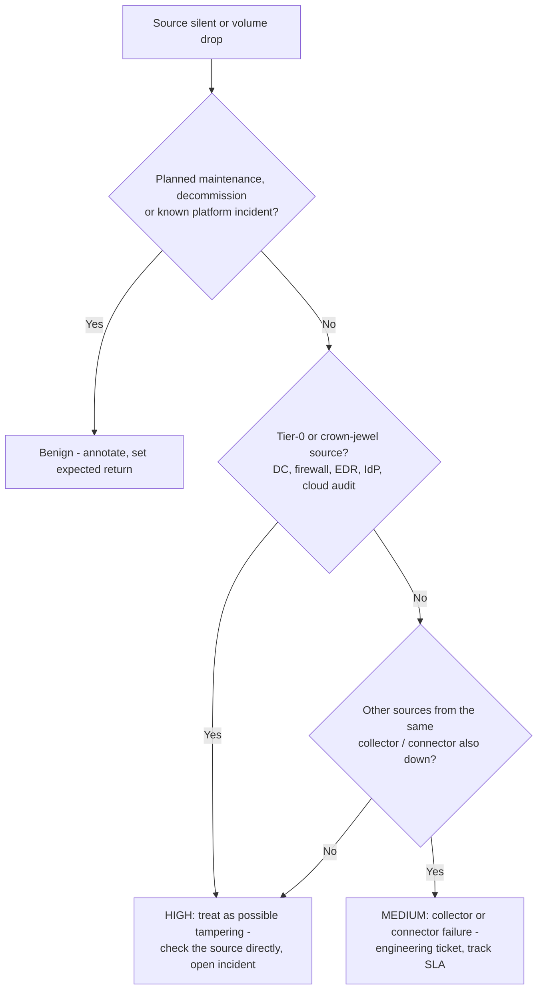

# Log Source Silence / Ingestion Gap

> Every detection in this guide assumes the logs are arriving. When a firewall stops sending syslog, a DC's agent breaks, a diagnostic setting is deleted or a connector token expires, **the SOC goes blind without a single alert**. Attackers cause this deliberately, and operations cause it by accident every week. In a SOC with 30–50 source types, monitoring for silence is a detection in its own right.

## When this fires
**Hunt-driven.** Run it as a scheduled analytic every hour. Compare each source's last event time and volume with its baseline. Pair it with [log clearing](../endpoint/log-clearing-anti-forensics.md) and [cloud logging tampering](../cloud/cloud-logging-tampering.md).

## Triage decision tree


## Investigation steps
1. Tables that went quiet compared with their own baseline:
   ```kql
   let lookback = 7d; let silence = 2h;
   union withsource=SourceTable SecurityEvent, SigninLogs, AuditLogs, CommonSecurityLog, Syslog, AzureActivity, OfficeActivity, DeviceProcessEvents, AWSCloudTrail
   | where TimeGenerated > ago(lookback)
   | summarize LastSeen = max(TimeGenerated), Events7d = count() by SourceTable
   | where LastSeen < ago(silence)
   | extend SilentFor = now() - LastSeen
   | order by SilentFor desc
   ```
2. Per device or computer within multi-source tables (firewalls and servers stop individually):
   ```kql
   let silence = 2h;
   CommonSecurityLog
   | where TimeGenerated > ago(3d)
   | summarize LastSeen = max(TimeGenerated), Events = count() by DeviceVendor, DeviceProduct, Computer
   | where LastSeen < ago(silence)
   | order by LastSeen asc
   ```
   Repeat for `SecurityEvent` by `Computer`, `Syslog` by `HostName`, and `Heartbeat` by `Computer` for agent health.
3. Check the pipeline: collector or forwarder health, connector status pages, expired secrets or API tokens, diagnostic settings, and daily ingestion caps (a cap silently drops data once reached).
4. If a security-relevant source went silent unexpectedly, review what happened on that asset just before (logons, admin actions, agent stops).

## True vs false positive

| Points to tampering | Points to benign |
|---|---|
| Only the Security log of one DC stops; other channels continue | Whole collector down; all its sources stopped together |
| Diagnostic setting deleted by an unusual actor | Connector secret expired (date matches) |
| Silence starts right after an admin logon | Device decommissioned per the CMDB |

## Containment & response
- Restore the flow (agent, collector, connector, diagnostic setting); backfill from the source if possible.
- For suspected tampering: investigate the asset as compromised until proven otherwise.
- Make silence visible: per-source expected-volume baselines, a health workbook, an owner per log source, and an SLA for restoring ingestion. Alert on reaching the daily ingestion cap.

## Escalation criteria
Unexplained silence of a tier-0 or crown-jewel source, or silence that coincides with other suspicious activity → IR.

## Evidence to collect
Last-seen times per source, pipeline / collector logs, change records, activity on the asset around the silence.
