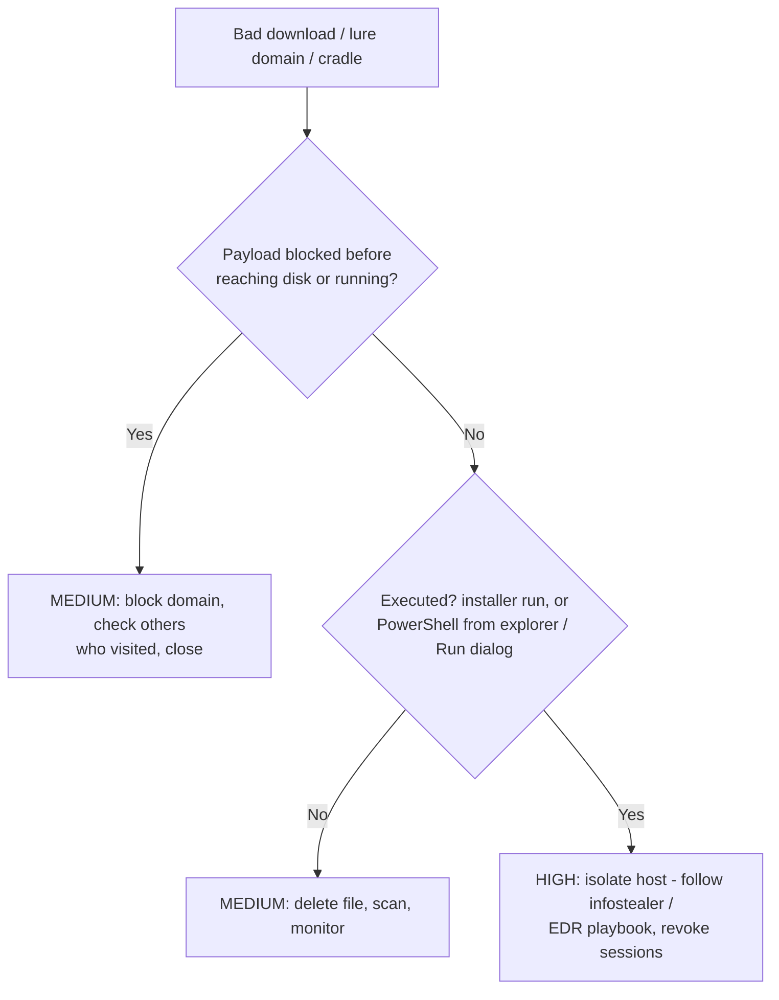

# Malicious Download, Malvertising and ClickFix Lures

> Users search for software (a PDF editor, a VPN client, "Teams download") and land on a **poisoned search result or ad** serving a trojanised installer. Or a compromised site shows a fake CAPTCHA that tells them to press **Win+R, paste and Enter** ("ClickFix"), which runs PowerShell they never see. These lures deliver most infostealers and many ransomware loaders today.

## When this fires
- `umb_phishing_blocked`, `umb_newly_seen_domains_burst` / `newly-observed-domain`, `ti-domain-match-dns`: visits to known-bad or newly registered domains
- `fgt_av_malware_detected` / `threat-intel-file-hash-match`: malware detected in a download
- `win_powershell_download_cradle`: PowerShell download-and-execute, the ClickFix payload

## Triage decision tree


## Investigation steps
1. ClickFix signature: PowerShell or mshta launched by `explorer.exe` (the Run dialog), with a download cradle:
   ```kql
   DeviceProcessEvents
   | where TimeGenerated > ago(7d)
   | where InitiatingProcessFileName =~ "explorer.exe" and FileName in~ ("powershell.exe", "pwsh.exe", "mshta.exe", "cmd.exe")
   | where ProcessCommandLine has_any ("iwr", "irm", "Invoke-WebRequest", "Invoke-RestMethod", "DownloadString", "http", "-enc", "mshta")
   | project TimeGenerated, DeviceName, AccountName, FileName, ProcessCommandLine
   ```
   The `RunMRU` registry key on the host also records what was pasted.
2. For installer lures: the download URL and referrer (proxy logs), the file's signer (often signed with a stolen or freshly bought certificate), and child processes after install.
3. Scope the campaign: other users who visited the same domain or downloaded the same hash (DNS, proxy, EDR file events).
4. If executed: go straight to [infostealer infection](../endpoint/infostealer-infection.md), because session theft starts immediately.

## True vs false positive

| Points to attack | Points to benign |
|---|---|
| Download from a lookalike vendor domain reached through a search ad | Download from the vendor's real domain via the software portal |
| PowerShell with `irm …` piped to `iex`, launched by explorer right after visiting a "verify you are human" page | Admin running a known script from the Run dialog |
| Installer signed by an unrelated company | Signed by the real vendor, matching published hashes |

## Containment & response
- Isolate executed hosts; block domains, URLs and hashes at DNS, proxy and EDR.
- Revoke sessions and reset credentials for affected users if anything ran.
- Prevent: a software portal / approved-download process, ad blocking via DNS security, blocking newly registered domains, ASR rules, restricting the Run dialog and PowerShell for standard users where feasible, and user awareness of "paste this command" lures.

## Escalation criteria
Execution with follow-on activity (stealer, loader, C2), or many users hitting the same lure → IR.

## Evidence to collect
URLs and referrers, downloaded file and hash, process tree, RunMRU contents, list of other visitors.
