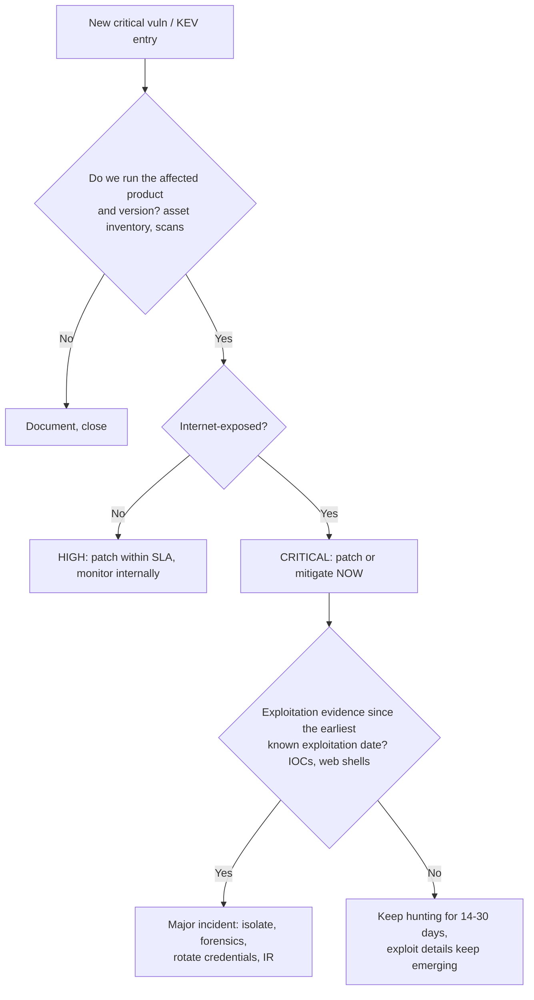

# Mass Exploitation of a New Vulnerability (KEV Response)

> A critical bug in an internet-facing product (VPN, firewall, file transfer, collaboration server) is disclosed. Exploitation starts within hours, often **before** you can patch, and web shells or implants are planted at scale. This playbook is the SOC's 24-hour response. The question is not "are we patched?" but "**were we compromised before we patched?**"

## When this fires
- An advisory (vendor PSIRT, CISA KEV addition, national CERT) for a product you run
- `web_log4shell_jndi`, `web_command_injection`, `web_path_traversal`, `fgt_sslvpn_exploit_attempt` / `web-exploit-patterns-in-url`, `waf-attack-burst`: exploitation attempts against exposed services
- `web_webshell_access` / `webserver-spawns-shell`: post-exploitation

## Triage decision tree


## Investigation steps
1. Confirm exposure: asset inventory, external attack-surface scan, and the version on each instance. Do not rely on CMDB alone.
2. Look back to the **earliest known exploitation date** (usually earlier than disclosure), not just since the advisory:
   ```kql
   let cutoff = ago(30d);
   CommonSecurityLog
   | where TimeGenerated > cutoff
   | where RequestURL has_any ("${jndi:", "../", "%2e%2e", ";wget", "|curl", "/cgi-bin/", "<EXPLOIT_PATH_FROM_ADVISORY>")
   | summarize Hits = count(), Actions = make_set(DeviceAction), URLs = make_set(RequestURL, 10) by SourceIP, DestinationIP
   | order by Hits desc
   ```
3. Apply the vendor and CERT IOCs (hashes, file paths, web shell names, C2 IPs) across EDR, proxy, DNS and firewall logs, and run the vendor's integrity-check tool on appliances.
4. On each exposed host: new files in web roots, new admin accounts, configuration changes, outbound connections from the server itself.

## True vs false positive

| Points to compromise | Points to benign |
|---|---|
| Exploit request followed by a 200 response and a new file in the web root | Exploit requests blocked by WAF / IPS with no backend effect |
| Appliance connects outbound to IOC infrastructure | Internet-wide scanning against a patched version |
| New admin account or config change near the exploit time | Change by the patching team during the emergency window |

## Containment & response
- Patch or apply the vendor mitigation; if neither is possible, take the service off the internet.
- If compromise is found: isolate, image, rebuild from known-good (appliances may need a factory reset), and rotate every credential the system held or saw.
- Keep hunting as new IOCs are published; record exposure windows for each asset.
- Communicate status to leadership early (exposed? patched? compromised?) with timestamps.

## Escalation criteria
Any exploitation evidence on an exposed asset → major incident.

## Evidence to collect
Asset and version list, patch / mitigation times, WAF / IPS / web logs from the earliest exploitation date, IOC search results, forensic images.
