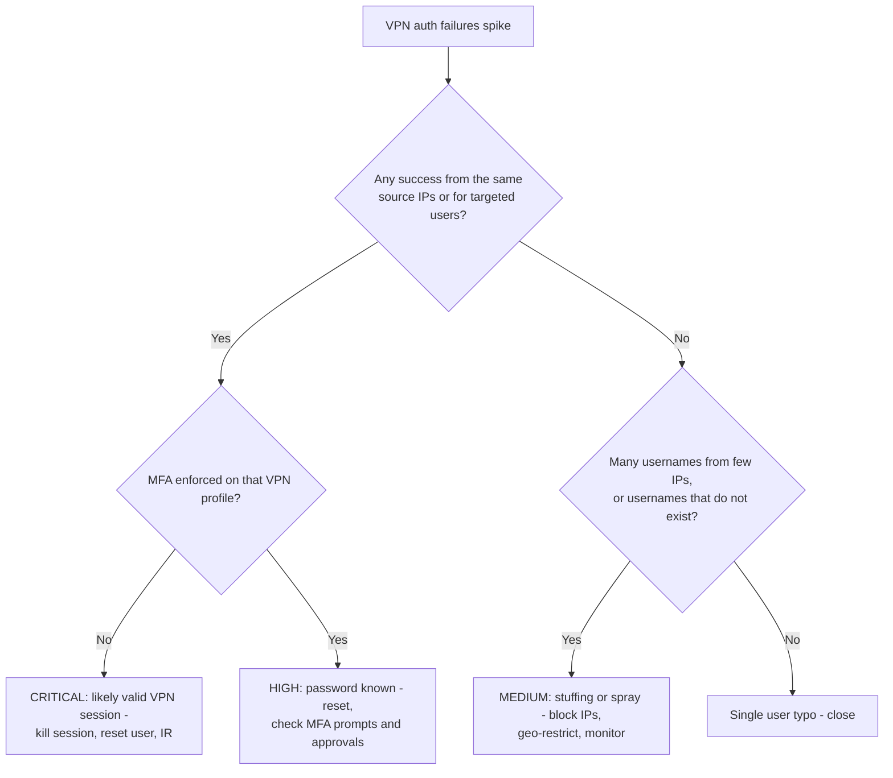

# VPN Brute Force / Credential Stuffing

> Internet-facing VPN portals are hammered with leaked username and password pairs (credential stuffing) and sprays. Many VPNs still authenticate with a password alone, or with a weak second factor. One success gives **a network-level foothold inside the perimeter**.

## When this fires
- `fgt_sslvpn_bruteforce`: many FortiGate SSL-VPN authentication failures from one source or for many users
- `asa_vpn_auth_failures`: Cisco ASA / FTD AnyConnect authentication failures (e.g. 113015, 716039) above threshold
- `ti-ip-match-firewall`: a VPN source IP matches threat intelligence

## Triage decision tree


## Investigation steps
1. Failures and successes by source:
   ```kql
   CommonSecurityLog
   | where TimeGenerated > ago(1d)
   | where DeviceVendor in ("Fortinet", "Cisco") and (Activity has_any ("ssl-login-fail", "ssl-login", "tunnel-up", "auth") or DeviceEventClassID in ("113015", "113004", "722022", "716039"))
   | summarize Failures = countif(Activity has "fail" or DeviceEventClassID in ("113015", "716039")),
               Successes = countif(Activity has_any ("tunnel-up", "login-success") or DeviceEventClassID in ("113004", "722022")),
               Users = dcount(SourceUserName) by SourceIP
   | order by Failures desc
   ```
   Event IDs and activity names vary by firmware and parser, so confirm the success and failure markers in your own data first.
2. For each successful user: VPN-assigned IP, session duration, and internal connections made (firewall logs from the VPN pool), especially to DCs, file servers and RDP.
3. Check whether the source IPs are known stuffing infrastructure (TI, residential proxy ASNs) and whether the targeted usernames match a public breach.
4. Patch status: check whether the VPN firmware has open critical CVEs ([edge exploitation](edge-device-exploitation.md)).

## True vs false positive

| Points to attack | Points to benign |
|---|---|
| Hundreds of usernames from a few IPs | One user with an expired password retrying |
| Success after many failures, from a new country | Monitoring probe with a known account |
| Usernames in `firstname.lastname` format that do not exist | Failures during an IdP / RADIUS outage |

## Containment & response
- Kill suspicious VPN sessions and reset the affected users' passwords; review their internal activity.
- Block source IPs and ASNs; geo-restrict the VPN portal where business allows.
- **Enforce phishing-resistant or certificate-based MFA** on every VPN profile; disable local VPN accounts.
- Add lockout or rate limiting on the portal, and alert on any success following a failure burst.

## Escalation criteria
Any successful VPN session tied to the attack, or VPN without MFA → IR.

## Evidence to collect
VPN authentication logs, session records with assigned IPs, internal traffic from those IPs, and source IP intelligence.
