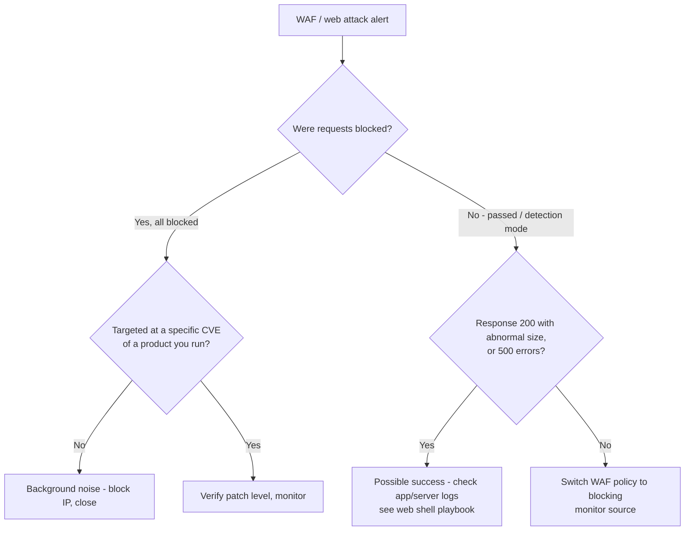

# Web Application Attack (WAF)

> WAFs block thousands of attacks a day. The SOC only needs to care about two questions: **did any attack get through, and did it work?**

## When this fires
- `web_sqli_attempt` (SecOps): SQL injection patterns in the request URL (UNION SELECT, boolean tautologies, time-based sleep/benchmark/waitfor, xp_cmdshell, INTO OUTFILE)
- `web_log4shell_jndi` (SecOps): JNDI lookup strings (Log4Shell CVE-2021-44228 and obfuscations) in URL, user agent or referrer
- `web_path_traversal` (SecOps): Directory traversal sequences or sensitive file paths in requests (../, encoded variants, /etc/passwd, win.ini)
- `web_command_injection` (SecOps): OS command injection payloads in the URL (;id, |whoami, $(curl ...), backticks)
- `web_ssrf_cloud_metadata` (SecOps): Requests containing cloud metadata endpoints (169.254.169.254, metadata.google.internal) - SSRF to steal instance credentials (Capital One breach pattern)
- `web_waf_block_spike` (SecOps): 50+ WAF blocks for one source within 10 minutes - active attack or aggressive scanning
- `f5_asm_attack_passed_transparent` (SecOps): ASM detected an attack signature but passed the request (policy in transparent / staging mode) - the attack reached the application
- `azwaf_detection_mode_match` (SecOps): Azure WAF matched a rule but did not block (Detection mode) - the request reached the backend
- `fweb_high_severity_attack` (SecOps): FortiWeb attack log with high or critical severity from one source
- `hd_waf_attack_spike` (SecOps): 50+ Haltdos WAF blocks for one source within 10 minutes
- `waf-attack-burst` (Sentinel): 25+ WAF matches (SQL injection, XSS, LFI, RCE rule groups) from one client IP within 10 minutes on Azure Application Gateway
- `web-exploit-patterns-in-url` (Sentinel): Proxy/WAF CEF logs (RequestURL) containing high-confidence exploit strings: JNDI lookups, directory traversal to sensitive files, cloud metadata SSRF and shell command injection
- `waf-detection-mode-hits` (Sentinel): Application Gateway WAF rule matches with action 'Matched'/'Detected' rather than 'Blocked': the request reached your application

## Triage decision tree


## Investigation steps
1. Requests from the source: blocked vs passed, URLs, parameters, response codes and sizes.
   ```
   metadata.event_type = "NETWORK_HTTP" and principal.ip = "<SRC_IP>"
   ```
2. For passed requests: matching application/server logs and backend errors (SQL errors, stack traces).
3. For SSRF / Log4Shell: outbound connections from the web server to unknown hosts or the metadata endpoint.
4. Is the source a scanner (user agent, ASN) or targeted (low volume, precise payloads)?

## True vs false positive

| Points to attack | Points to benign |
|---|---|
| Attack requests that got 200 responses, or WAF in detection mode | Requests blocked (403) by the WAF with no backend errors |
| Payload matches a vulnerable component you run (e.g. Log4j, a CMS plugin) | Authorized DAST scan from known scanner IPs |
| Followed by a web shell or an outbound connection from the web server | Internet background scanning against non-existent paths |

## Containment & response
- Block the source IP/ASN at the WAF; virtual-patch the targeted CVE.
- Move policies from detection/transparent to blocking mode.
- If exploitation succeeded: isolate backend, rotate app secrets, run the web shell playbook.

## Escalation criteria
Any passed attack with evidence of success, or targeted exploitation of an unpatched CVE → IR.

## Evidence to collect
WAF logs (blocked + passed), backend logs, payload samples, source enrichment.
