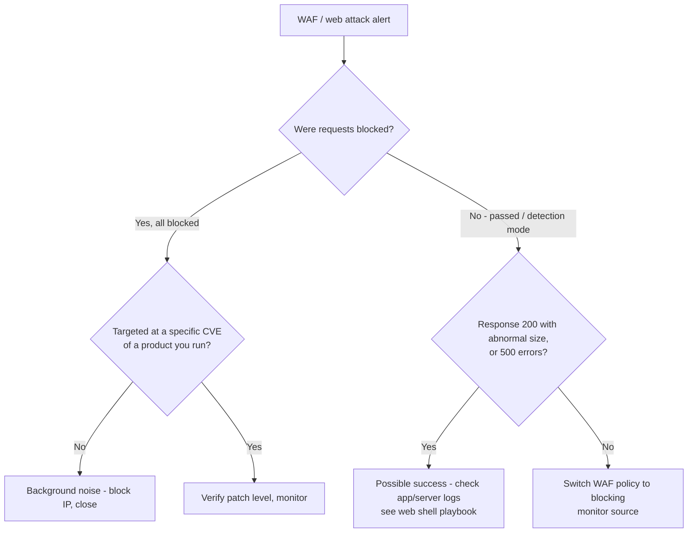

# Web Application Attack (WAF)

> WAFs block thousands of attacks a day. The SOC only needs to care about two questions: **did any attack get through, and did it work?**

## Triage decision tree


## Investigation steps
1. Requests from the source: blocked vs passed, URLs, parameters, response codes and sizes.
   ```
   metadata.event_type = "NETWORK_HTTP" and principal.ip = "<SRC_IP>"
   ```
2. For passed requests: matching application/server logs and backend errors (SQL errors, stack traces).
3. For SSRF / Log4Shell: outbound connections from the web server to unknown hosts or the metadata endpoint.
4. Is the source a scanner (user agent, ASN) or targeted (low volume, precise payloads)?

## Containment & response
- Block the source IP/ASN at the WAF; virtual-patch the targeted CVE.
- Move policies from detection/transparent to blocking mode.
- If exploitation succeeded: isolate backend, rotate app secrets, run the web shell playbook.

## Escalation criteria
Any passed attack with evidence of success, or targeted exploitation of an unpatched CVE → IR.

## Evidence to collect
WAF logs (blocked + passed), backend logs, payload samples, source enrichment.
