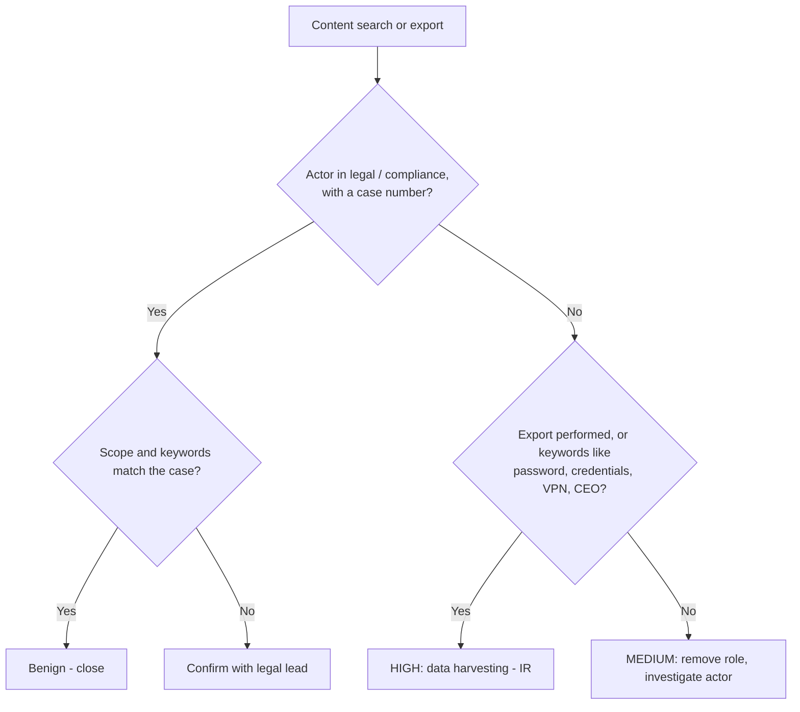

# eDiscovery / Content Search Abuse

> A Purview content search can read **every mailbox, site and Teams chat in the tenant** and export the results. An attacker with eDiscovery rights, or a curious insider, can quietly harvest years of mail. Searches for words such as "password", "VPN" or "invoice", and exports, are the warning signs.

## When this fires
- `m365_ediscovery_search`: `New-ComplianceSearch`, `Start-ComplianceSearch`, `New-ComplianceSearchAction -Export` / `SearchExported`, or an eDiscovery role assignment

## Triage decision tree


## Investigation steps
1. Pull the search definition (query, locations) and any export actions:
   ```kql
   OfficeActivity
   | where TimeGenerated > ago(30d)
   | where Operation has_any ("ComplianceSearch", "SearchExported", "SearchCreated", "SearchStarted", "CaseAdded")
   | project TimeGenerated, UserId, Operation, ClientIP, Parameters, OfficeObjectId
   ```
2. Check how the actor got the role: recent membership of *eDiscovery Manager* / *Compliance Administrator*, and who granted it.
3. Review the actor's sign-in health and any other admin actions in the same session.
4. If exported: find the download (`SearchExportDownloaded`) and the device used.

## True vs false positive

| Points to abuse | Points to benign |
|---|---|
| All-mailbox search for credentials or for executive names | Legal hold search with a case ID |
| Role assigned to the actor the same day | Long-standing compliance analyst |
| Export downloaded to an unmanaged device | Export to the approved review platform |

## Containment & response
- Remove eDiscovery roles from the actor, delete the search and its exports, and revoke sessions.
- Treat exported content as disclosed; scope it with legal and privacy.
- Restrict eDiscovery roles with PIM (approval plus justification) and alert on every export.

## Escalation criteria
Any unapproved search or export → IR and legal.

## Evidence to collect
Search definition and parameters, export and download records, role assignment history, and the actor's session.

> Sentinel: this activity is in `OfficeActivity` (and `CloudAppEvents` with Defender for Cloud Apps). There is no dedicated KQL rule in the library yet, so use the query above as a hunt.
